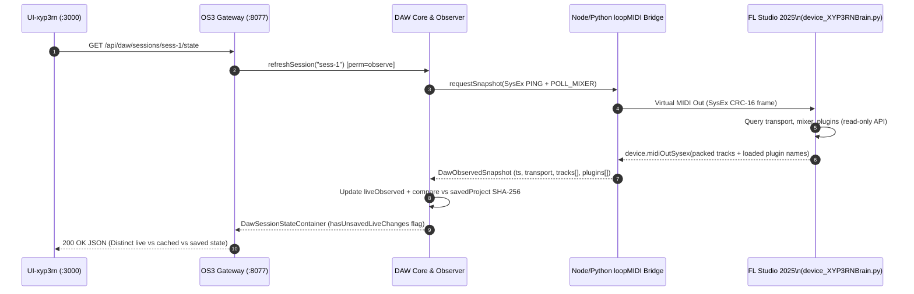
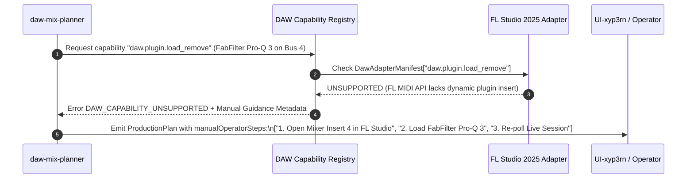
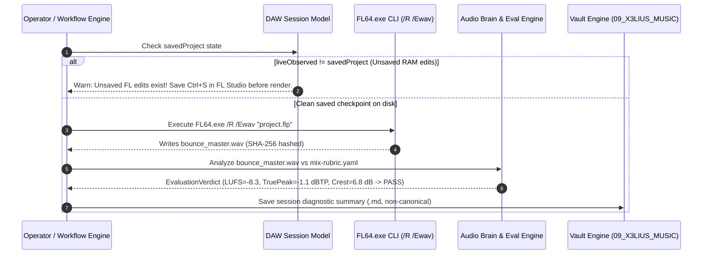
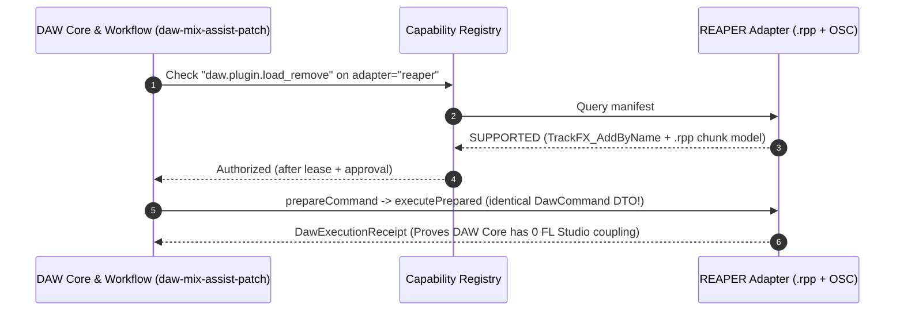

# XYP3RN DAW Brain — Execution Sequence Diagrams (Phase 02 Freeze)

**Status:** Phase 02 Architecture Freeze

---

## 1. Read-Only Live Observation (`FL Studio 2025` via Virtual MIDI Loopback)



---

## 2. Audio Brain -> Bounded Mix Patch -> Human Approval -> Execute -> Evaluate & Rollback

```mermaid
sequenceDiagram
  autonumber
  participant Op as Operator / UI-xyp3rn
  participant AB as Audio Brain\n(TRACE + Mix Rubric)
  participant PI as Production Intel &\nPlugin Brain
  participant CG as DAW Command Gateway\n(Clamps + Journal)
  participant DB as SQLite\n(pending_approvals)
  participant FL as FL Studio 2025 Bridge

  Op->>AB: POST /api/audio-brain/analyze (render.wav, stage="master")
  AB-->>Op: trace.report/v1 ("sub too high +2.4dB; ceiling -0.4dBTP -> lower target")
  Op->>PI: POST /api/daw/sessions/sess-1/propose (diagnostics)
  PI->>PI: Resolve loaded plugin semantic params (Pro-Q3 LowShelf gain)
  PI-->>Op: proposedModifications [cmd: plugin.param_write -2.2 dB]
  Op->>CG: POST /prepare { proposalId }
  CG->>FL: Read current param value (beforeState = 0.62)
  CG->>CG: Check delta <= 3.0 dB & target not drifted
  CG->>DB: Insert pending_approvals (status='pending', itemType='daw_patch')
  CG-->>Op: PreparedDawPatch (awaiting human approval)
  Op->>DB: POST /api/approvals/decide (decision='approved')
  Op->>CG: POST /execute { patchId, approvalId }
  CG->>FL: SysEx SET_PLUGIN_PARAM (slot=2, param=14, val=0.49)
  FL-->>CG: Readback verify (param=0.49 confirmed)
  CG->>DB: Append immutable daw_command_journal (before=0.62, after=0.49)
  alt Post-Evaluation Detects Regression
    Op->>CG: POST /rollback { receiptId }
    CG->>FL: SysEx SET_PLUGIN_PARAM (val=0.62 from beforeState)
  end
```

---

## 3. Unsupported Capability Handling (Rule: Report Unsupported, Never Simulate)



---

## 4. Headless Master Render (`FL64.exe /R`) & TRACE Rubric Verification Loop



---

## 5. Multi-DAW Architecture Portability Validation (REAPER Adapter Target)


