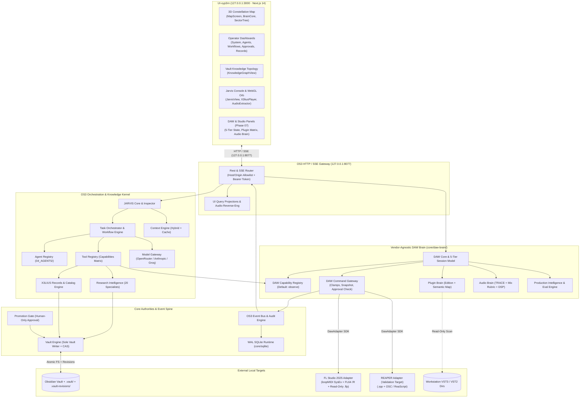
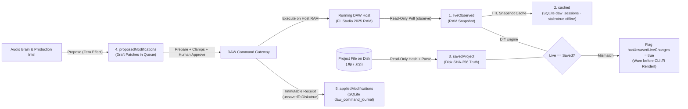
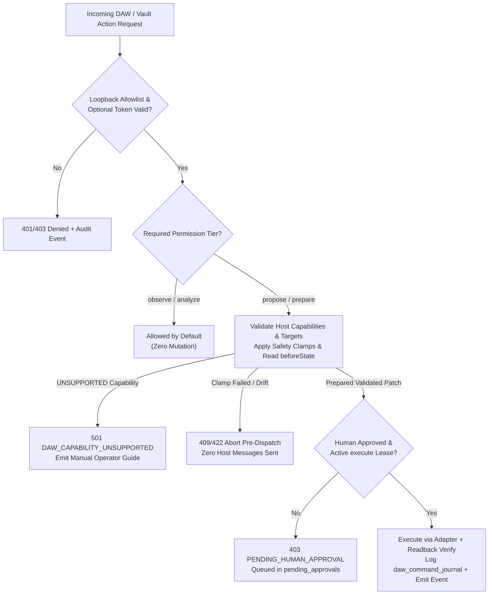

# XYP3RN OS 3.0 + DAW Brain — Architecture & Data Topology Diagrams (Phase 02 Freeze)

**Status:** Phase 02 Architecture Freeze

---

## 1. Master System Topology (OS3 + DAW Brain + Hosts)

---

## 2. Five-Tier DAW Session State & Storage Separation

---

## 3. Security & Capability Escalation Gate Flow

