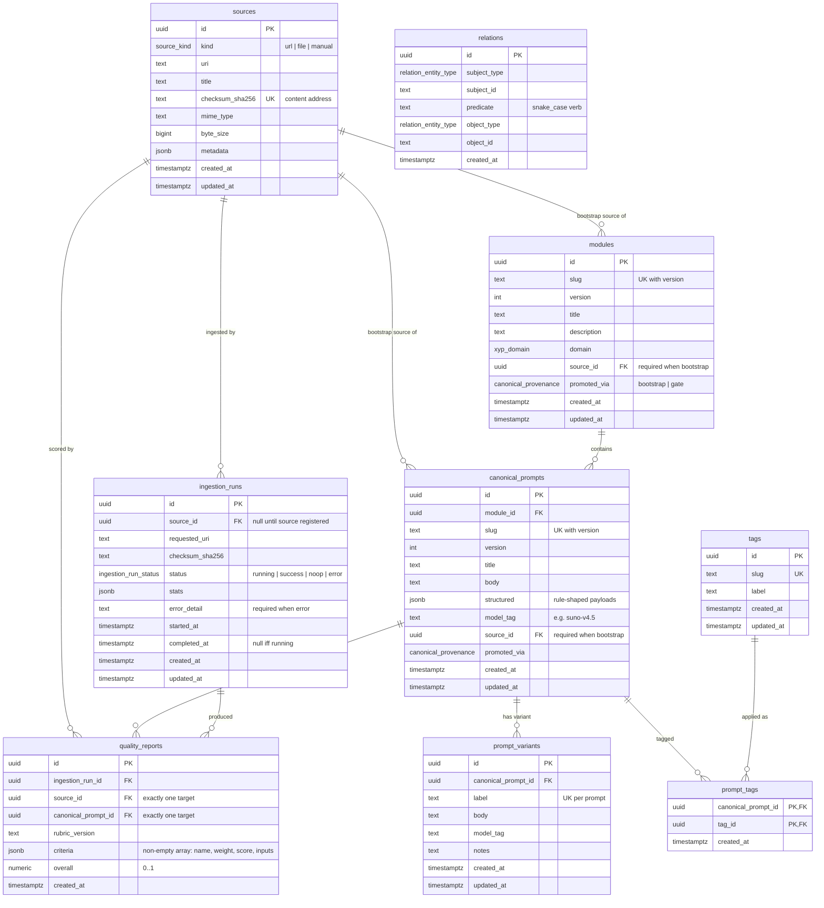

# Schema

Status: Phase 1 canonical base (Knowledge Layer) + Phase 2 ingest role + Phase 3 embeddings. Source of truth: `supabase/migrations/`. This doc explains the migrations and must not contradict them.

## ERD



`relations` has no drawn edges because it is polymorphic. See below.

## Design notes

- **Foreign keys are `ON DELETE RESTRICT`.** History is permanent, so deleting a parent that knowledge still references fails loudly. The only exception is `prompt_tags`, whose join rows cascade.
- **Sources are content-addressed.** `sources.checksum_sha256` is UNIQUE. This is the race fix for Phase 2: two concurrent ingestions of the same bytes collapse to one row through `ON CONFLICT`, instead of relying on a check-then-insert in application code.
- **Canonical rows are versioned by `(slug, version)`, not unique by slug alone.** Phase 6D appends a new version and a `knowledge_versions` row instead of overwriting. Deciding which version is "current" is 6D's job.
- **`promoted_via` records provenance.** `bootstrap` rows were written by Phase 2 before the gate existed (F1), and a CHECK constraint requires them to carry `source_id`. `gate` rows trace their origin through `knowledge_versions` → `knowledge_candidates` (6D), so their `source_id` may be null.
- **Quality reports are immutable and self-explaining.** `criteria` must be a non-empty array, so a score cannot exist without the inputs that produced it. Each report targets exactly one of a source or a canonical prompt.
- **`relations` is polymorphic.** Ids are `text`, so file-backed entities such as an agent named `health-check` fit alongside uuids.
  - On insert or update, a trigger checks that table-backed endpoints exist and that file-backed names are kebab-case. Otherwise it raises `23503`.
  - An entity type added to the enum but not handled by `xyp_relation_endpoint_exists()` is rejected (deny by default).
  - Deleting an endpoint does not touch its edges. Orphaned edges show up in the `relations_dangling` view.
- **Enums.** `xyp_domain` is a copy of `core/contracts/taxonomy.ts`, and `tests/phase-01` fails if they drift apart. Later phases extend `relation_entity_type` with `ALTER TYPE … ADD VALUE`.
- **`updated_at`.** Mutable tables get `xyp_set_updated_at()`, which uses `clock_timestamp()` so an insert and an update in the same transaction still produce distinct times. `prompt_tags`, `relations` and `quality_reports` have no `updated_at` because they are insert/delete-only.

## Access model (Phase 1)

- **RLS:** enabled on every table, with no policies, so the default is deny.
- **`anon` / `authenticated`:** every privilege on every table, view and function is explicitly revoked. Supabase grants them ALL on new public tables by default, and RLS alone still leaves TRUNCATE, REFERENCES and TRIGGER open. `tests/phase-01` proves a read as `anon` fails with `42501`, not a silent empty result.
- **`service_role`:** full grants plus BYPASSRLS. That is correct for Phase 1 only. From Phase 2 onward each component connects as its own `xyp_*` role (F7), and Phase 6D revokes canonical writes from everything except the gate.
- **Table owner:** the migration role (`postgres`), which is trusted by definition and never used by application code. This drops the `xyp_owner` role proposed in F7, because ownership by a separate non-login role adds nothing when the owner never connects.

**Multi-tenant RLS: not added. Flagged:**

1. If the Phase 16 UI reads from the browser with the anon key, it will need per-role policies. Recommendation: have the UI read server-side through a read-only `xyp_*` role, and keep the browser off the database.
2. If an external portal for payees or collaborators ever exists (Phase 13 `rights_splits`), real per-row tenant RLS becomes necessary on the Records tables.

## Phase 2 additions: `xyp_ingest_bootstrap`

Migration `20260924090000_ingest_bootstrap_role.sql` adds the temporary pre-gate canonical writer (F1):

| Table | SELECT | INSERT | UPDATE | DELETE/TRUNCATE |
|---|---|---|---|---|
| `sources`, `modules`, `canonical_prompts`, `tags`, `prompt_tags`, `relations`, `quality_reports` | yes | yes | — | — |
| `ingestion_runs` | yes | yes | outcome columns only: `source_id`, `checksum_sha256`, `status`, `stats`, `error_detail`, `completed_at` | — |
| `prompt_variants` | — | — | — | — |

- **Role attributes:** NOLOGIN, not superuser, no BYPASSRLS. Services assume it with `SET LOCAL ROLE` inside a transaction.
- **Row access:** it sees rows through per-role policies (`ingest_bootstrap_select` / `_insert` / `_update`), using `true` because the OS is single-tenant. The grants do the restricting.
- **Rollback:** removes this database's grants and policies but not the role itself. Roles are cluster-wide, so dropping one is a manual operation.
- **Phase 6D:** revokes its canonical INSERT.

## Phase 3 additions: embeddings + retrieval roles

Migration `20260924100000_embeddings.sql`:

- **pgvector** lives in the `extensions` schema (the Supabase convention).
- **New columns** on `canonical_prompts` and `sources`: `embedding vector(384)`, `embedding_model`, `embedding_input_sha256`, `embedding_truncated`, `embedded_at`.
  - A CHECK constraint keeps them all-or-nothing: `num_nulls(...) in (0, 5)`.
  - The input hash includes the model id, so changing models re-embeds every row rather than mixing vector spaces.
- **Indexes:** HNSW with `vector_cosine_ops` on both columns.
- **`xyp_match_knowledge(query vector, limit)`:** nearest neighbours across both tables. Each branch is ordered by distance with its own LIMIT so the index is used, and `similarity = 1 - cosine distance`.
- **Roles:**

| Role | Can | Can't |
|---|---|---|
| `xyp_embedder` | SELECT `canonical_prompts`, `sources`, `modules`; UPDATE only the 5 embedding columns | touch content columns, INSERT, DELETE |
| `xyp_runtime` | SELECT knowledge tables; EXECUTE `xyp_match_knowledge` | any write (retrieval also runs in a `read only` transaction) |

- **`updated_at`:** writing an embedding bumps `updated_at` through the Phase 1 trigger. That is intended, because retrieval results change once a row is embedded, and the Context Engine's cache key includes `max(updated_at)`.

## Phase 4A additions: `agent_runs`

Migration `20260924110000_agent_runs.sql` adds the generic execution log. Its columns are `agent_name`, `class xyp_agent_class`, `domain xyp_domain`, `input`, `output`, `tokens_used`, `latency_ms`, `status agent_run_status (pending|success|error)`, `error_detail`, `created_at` and `completed_at`. It is indexed on `(agent_name, created_at)` and `(status)`.

- **Append-then-seal:**
  - `xyp_runtime` has INSERT and SELECT, plus UPDATE on the outcome columns only (`status`, `output`, `error_detail`, `completed_at`, `tokens_used`, `latency_ms`).
  - The identity columns (`agent_name`, `class`, `domain`, `input`, `created_at`) can't be changed after insert (`42501`).
  - The trigger `trg_agent_runs_seal` rejects any UPDATE once a row has left `pending` (`55000`). It applies to every role, the table owner included.
- **CHECK constraints:**
  - `completed_at` is set exactly when the status isn't `pending`.
  - `error` rows must carry `error_detail`.
- **Nullable identity:** `class` and `domain` stay null only when the agent could not be resolved, so failed dispatches are still logged. `agent_name` is free text for the same reason.

## Adding a table (checklist, every phase)

1. Idempotent DDL (`if not exists`, `create or replace`, enum creation wrapped in a `duplicate_object` catch).
2. `enable row level security`, `revoke all … from anon, authenticated`, then explicit grants for the roles that need them.
3. A matching `supabase/rollbacks/<stem>.down.sql` with no CASCADE.
4. Tests in `tests/phase-NN/`, with the negative case asserting an exact SQLSTATE.

## Running it

```sh
pnpm db:setup        # local PG16 + pgvector + emulated Supabase roles (idempotent)
pnpm db:up           # apply pending migrations (XYP_DATABASE_URL, default local)
pnpm db:status
pnpm db:down [n|all] # roll back newest-first
pnpm db:seed:proof   # FK-proof seed in a rolled-back transaction
pnpm test            # each DB test file gets its own throwaway database
```
