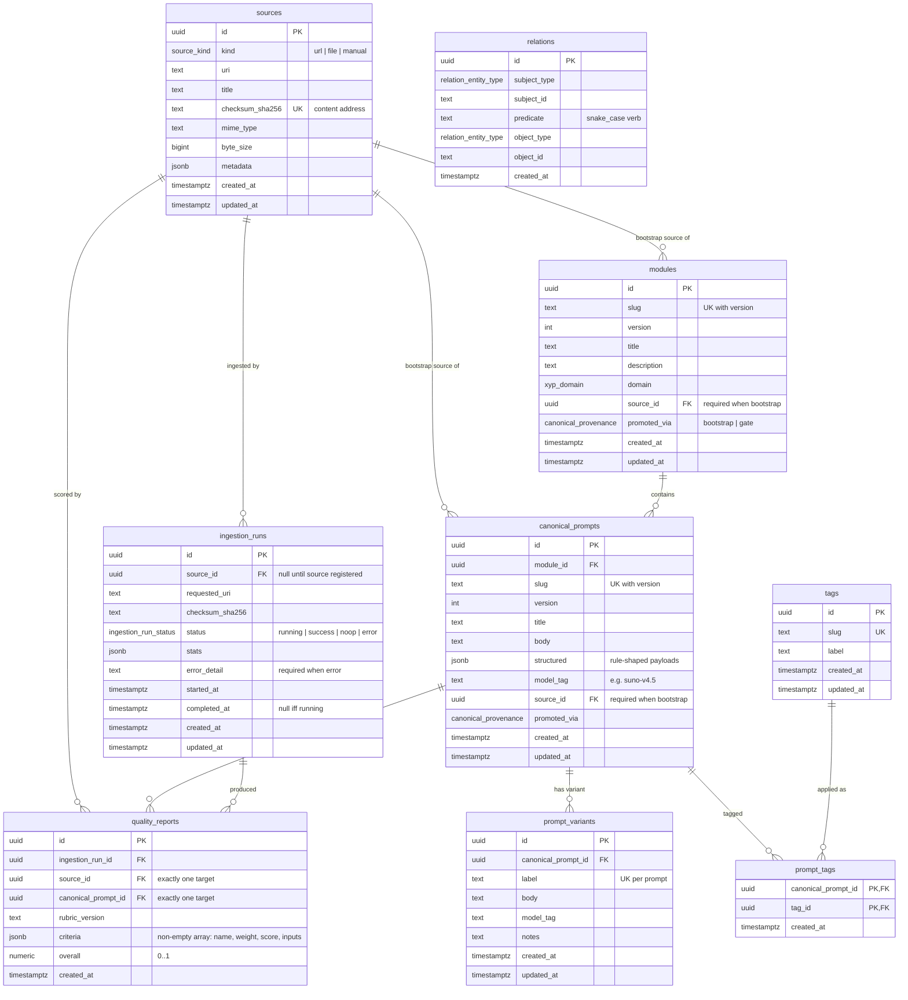

# Schema

Status: through Phase 9 (Suno submissions, takes, stub scoring) + F16 (current versions on the global path). The ERD shows the Phase 1 canonical base; later phases are described in their sections below. Source of truth: `supabase/migrations/`. This doc explains the migrations and must not contradict them.

## ERD



`relations` has no drawn edges because it is polymorphic. See below.

## Design notes

- **Foreign keys are `ON DELETE RESTRICT`.** History is permanent, so deleting a parent that knowledge still references fails loudly. The only exception is `prompt_tags`, whose join rows cascade.
- **Sources are content-addressed.** `sources.checksum_sha256` is UNIQUE. This is the race fix for Phase 2: two concurrent ingestions of the same bytes collapse to one row through `ON CONFLICT`, instead of relying on a check-then-insert in application code.
- **Canonical rows are versioned by `(slug, version)`, not unique by slug alone.** The gate (6D) appends a new version and a `knowledge_versions` row instead of overwriting. The newest version of a slug is current (`canonical_claims` and the Context Engine read it that way).
- **`promoted_via` records provenance.**
  - `bootstrap` rows were written by Phase 2 before the gate existed (F1). A CHECK constraint requires them to carry `source_id`.
  - `gate` rows trace their origin through `knowledge_versions` → `promotion_runs`, and from there to either the candidate chain or the first-party source. Candidate-promoted rows have a null `source_id`; first-party admissions keep theirs.
- **Quality reports are immutable and self-explaining.** `criteria` must be a non-empty array, so a score cannot exist without the inputs that produced it. Each report targets exactly one of a source or a canonical prompt.
- **`relations` is polymorphic.** Ids are `text`, so file-backed entities such as an agent named `health-check` fit alongside uuids.
  - On insert or update, a trigger checks that table-backed endpoints exist and that file-backed names are kebab-case. Otherwise it raises `23503`.
  - An entity type added to the enum but not handled by `xyp_relation_endpoint_exists()` is rejected (deny by default).
  - Deleting an endpoint does not touch its edges. Orphaned edges show up in the `relations_dangling` view.
- **Enums.** `xyp_domain` is a copy of `core/contracts/taxonomy.ts`, and `tests/phase-01` fails if they drift apart. Later phases extend `relation_entity_type` with `ALTER TYPE … ADD VALUE`.
- **`updated_at`.** Mutable tables get `xyp_set_updated_at()`, which uses `clock_timestamp()` so an insert and an update in the same transaction still produce distinct times. `prompt_tags`, `relations` and `quality_reports` have no `updated_at` because they are insert/delete-only.

## Access model (Phase 1)

- **RLS:** enabled on every table, with no policies, so the default is deny.
- **`anon` / `authenticated`:** every privilege on every table, view and function is explicitly revoked. Supabase grants them ALL on new public tables by default, and RLS alone still leaves TRUNCATE, REFERENCES and TRIGGER open. `tests/phase-01` proves a read as `anon` fails with `42501`, not a silent empty result.
- **`service_role`:** full grants plus BYPASSRLS. That is correct for Phase 1 only. From Phase 2 onward each component connects as its own `xyp_*` role (F7), and Phase 6D revokes canonical writes from everything except the gate.
- **Table owner:** the migration role (`postgres`), which is trusted by definition and never used by application code. This drops the `xyp_owner` role proposed in F7, because ownership by a separate non-login role adds nothing when the owner never connects.

**Multi-tenant RLS: not added. Flagged:**

1. If the Phase 16 UI reads from the browser with the anon key, it will need per-role policies. Recommendation: have the UI read server-side through a read-only `xyp_*` role, and keep the browser off the database.
2. If an external portal for payees or collaborators ever exists (Phase 13 `rights_splits`), real per-row tenant RLS becomes necessary on the Records tables.

## Phase 2 additions: `xyp_ingest_bootstrap`

Migration `20260924090000_ingest_bootstrap_role.sql` adds the temporary pre-gate canonical writer (F1):

| Table | SELECT | INSERT | UPDATE | DELETE/TRUNCATE |
|---|---|---|---|---|
| `sources`, `modules`, `canonical_prompts`, `tags`, `prompt_tags`, `relations`, `quality_reports` | yes | yes | — | — |
| `ingestion_runs` | yes | yes | outcome columns only: `source_id`, `checksum_sha256`, `status`, `stats`, `error_detail`, `completed_at` | — |
| `prompt_variants` | — | — | — | — |

- **Role attributes:** NOLOGIN, not superuser, no BYPASSRLS. Services assume it with `SET LOCAL ROLE` inside a transaction.
- **Row access:** it sees rows through per-role policies (`ingest_bootstrap_select` / `_insert` / `_update`), using `true` because the OS is single-tenant. The grants do the restricting.
- **Rollback:** removes this database's grants and policies but not the role itself. Roles are cluster-wide, so dropping one is a manual operation.
- **Phase 6D:** revokes its canonical INSERT.

## Phase 3 additions: embeddings + retrieval roles

Migration `20260924100000_embeddings.sql`:

- **pgvector** lives in the `extensions` schema (the Supabase convention).
- **New columns** on `canonical_prompts` and `sources`: `embedding vector(384)`, `embedding_model`, `embedding_input_sha256`, `embedding_truncated`, `embedded_at`.
  - A CHECK constraint keeps them all-or-nothing: `num_nulls(...) in (0, 5)`.
  - The input hash includes the model id, so changing models re-embeds every row rather than mixing vector spaces.
- **Indexes:** HNSW with `vector_cosine_ops` on both columns.
- **`xyp_match_knowledge(query vector, limit)`:** nearest neighbours across both tables. Each branch is ordered by distance with its own LIMIT so the index is used, and `similarity = 1 - cosine distance`.
- **Roles:**

| Role | Can | Can't |
|---|---|---|
| `xyp_embedder` | SELECT `canonical_prompts`, `sources`, `modules`; UPDATE only the 5 embedding columns | touch content columns, INSERT, DELETE |
| `xyp_runtime` | SELECT knowledge tables; EXECUTE `xyp_match_knowledge` | any write (retrieval also runs in a `read only` transaction) |

- **`updated_at`:** writing an embedding bumps `updated_at` through the Phase 1 trigger. That is intended, because retrieval results change once a row is embedded, and the Context Engine's cache key includes `max(updated_at)`.

## Phase 4A additions: `agent_runs`

Migration `20260924110000_agent_runs.sql` adds the generic execution log. Its columns are `agent_name`, `class xyp_agent_class`, `domain xyp_domain`, `input`, `output`, `tokens_used`, `latency_ms`, `status agent_run_status (pending|success|error)`, `error_detail`, `created_at` and `completed_at`. It is indexed on `(agent_name, created_at)` and `(status)`.

- **Append-then-seal:**
  - `xyp_runtime` has INSERT and SELECT, plus UPDATE on the outcome columns only (`status`, `output`, `error_detail`, `completed_at`, `tokens_used`, `latency_ms`).
  - The identity columns (`agent_name`, `class`, `domain`, `input`, `created_at`) can't be changed after insert (`42501`).
  - The trigger `trg_agent_runs_seal` rejects any UPDATE once a row has left `pending` (`55000`). It applies to every role, the table owner included.
- **CHECK constraints:**
  - `completed_at` is set exactly when the status isn't `pending`.
  - `error` rows must carry `error_detail`.
- **Nullable identity:** `class` and `domain` stay null only when the agent could not be resolved, so failed dispatches are still logged. `agent_name` is free text for the same reason.

## Phase 5 additions: `workflow_runs`

Migration `20260924120000_workflow_runs.sql` adds `workflow_runs`. Its columns are `workflow_name`, `spec_sha256` plus a `spec` snapshot, `input`, `output`, `status (running|success|error)`, `failed_step`, `skipped_steps`, `error_detail`, `created_at` and `completed_at`.

- **Seal:** the `trg_workflow_runs_seal` trigger seals a run once it leaves `running`.
- **Error rows:** an `error` row must name `failed_step` and carry `error_detail`.
- **Step linkage:** `agent_runs` gains `workflow_run_id` (FK, restrict) and `step_id`. They are set together at insert (pair CHECK) and can't be updated, because neither is in `xyp_runtime`'s UPDATE grant.

## Phase 6A additions: Research Intelligence schema

Migration `20260924130000_research_schema.sql` adds the 11 research tables plus the join `research_finding_evidence`. The chain, all real FKs, is `sources → research_sources → research_evidence → research_finding_evidence → research_findings → knowledge_candidates`. `contradictions` hangs off findings, `experiments` → `experiment_runs` hang off candidates, and so does `knowledge_versions`. `agent_runs.research_run_id` is new.

| Role | research chain | knowledge_candidates | canonical / knowledge_versions |
|---|---|---|---|
| `xyp_research` | INSERT + SELECT; UPDATE only on lifecycle columns of `research_runs`/`research_questions`/`research_projects`; no UPDATE or DELETE on evidence, findings or sources | INSERT only with `status = 'proposed'` (the RLS WITH CHECK rejects anything else with 42501); no UPDATE | SELECT only |

- **Evidence requirements:** `research_evidence` requires a source, `model_tag`, `confidence` in [0, 1] with `confidence_inputs`, and a non-empty claim, all NOT NULL.
- **Content addressing:** `research_sources` is unique by `content_sha256`, the same approach as `sources`.
- **Seal:** `research_runs` is sealed once it leaves `running`.

## Phase 6C additions: structured claims, Contradiction Engine, `xyp_verifier`

Migration `20260924140000_research_engines.sql`:

- **Structured claims:** `research_findings` and `knowledge_candidates` now require `claim_topic` (dotted kebab, e.g. `suno.vocal-descriptor-position`) and `claim_value jsonb`. On `research_evidence` the claim is optional, but topic and value must come together. Canonical rows carry claims in `structured.claims[] = {topic, value, model_scope}`.
- **`canonical_claims` view:** one row per claim on the latest version of each canonical slug.
- **Detection in the database:** `xyp_detect_contradictions()` (SECURITY DEFINER) runs AFTER INSERT on every finding and every candidate. A conflict is the same topic, an overlapping model scope (equal tags, or either side `model-agnostic`) and a different value. Different model versions never conflict. Research roles have no INSERT on `contradictions`, so they can neither fabricate nor suppress one.
- **`knowledge_candidate_eligibility` view:** a candidate is blocked while any open contradiction touches it, either through its own finding or by naming it as the target.
- **`xyp_verifier` role:** can UPDATE only `status`, `resolution` and `resolved_at` on `contradictions`, and can insert experiments and experiment runs. It cannot insert findings, evidence or contradictions.

## Phase 6D additions: Knowledge Promotion Gate (`xyp_promotion`), F1 closed

Migration `20260924150000_promotion_gate.sql`:

- **`xyp_promotion`** is the gate's service account and the only role with INSERT on `canonical_prompts`, `modules` and `knowledge_versions`. No role holds UPDATE on a canonical content column or DELETE/TRUNCATE on these tables; `xyp_embedder` keeps UPDATE on the five derived embedding columns only. A catalog test (`tests/phase-06d/canonical-grants.test.ts`) enumerates every role in the cluster to prove it.
- **History is required:** a deferred constraint trigger (`xyp_canonical_requires_history`) fails any transaction that commits a canonical row without its `knowledge_versions` row. This holds even for `xyp_promotion`.
- **F1 closed:**
  - `xyp_ingest_bootstrap` loses all canonical and graph grants and keeps only `sources` and `ingestion_runs`.
  - `service_role` loses INSERT/UPDATE/DELETE/TRUNCATE on `canonical_prompts`, `modules` and `knowledge_versions`.
  - Every pre-gate row is backfilled into `knowledge_versions` with `approval.mode = 'bootstrap'`.
  - New ingestion is admitted by the gate (`promoted_via = 'gate'`, `approval.mode = 'first-party-ingest'`), first-party origin only.
- **`knowledge_candidate_status`** gains `pending_approval`. A trigger enforces the state machine: `proposed → pending_approval | promoted | rejected`, then `pending_approval → promoted | rejected`. `promoted` and `rejected` are terminal.
- **`approval_queue`** (Governance-owned, F8) holds one row per item (`knowledge_candidate`, `critique_escalation`).
  - The gate may insert only `pending` rows.
  - A decision is written only by `xyp_decide_approval()` (SECURITY DEFINER, EXECUTE held by `service_role` alone) and is sealed once made.
- **`promotion_runs`** is append-only: one row per gate run, with every evaluated step and its reason, the outcome, the confidence and the threshold.
- **`regression_queue`** lists the checks a promotion owes (`retrieval`, `contradiction-guard`). It is consumed by the Phase 13 regression runner.
- **Deferred FKs:** `knowledge_versions.promotion_run_id` and `regression_queue.promotion_run_id` are deferred, so the run record is written last with the ids it produced.
- **Rollback:** refuses while first-party gate versions exist, because history is permanent.

## Phase 7 additions: module-scoped retrieval

Migration `20260924160000_subdomain_scope.sql`:

- **`xyp_match_knowledge_in_modules(query, limit, module_slugs[])`** backs the Context Engine's `scope: { modules }` option, which is a sub-domain's context path.
  - It searches only canonical prompts whose module slug is in the scope, across every version of the module.
  - Only the current version of each canonical slug is searched.
  - The scoped set is a MATERIALIZED CTE, so the scan is exact: a filtered HNSW scan can silently drop rows.
  - EXECUTE is held by `xyp_runtime` and `service_role`.
- **No new tables.** The X3LIUS Music System is data:
  - 11 gate-written `modules` rows (the parent plus ten sub-domains), admitted from `records/x3lius/music-system.manifest.yaml` by the `xyp-module-manifest-v1` normalizer.
  - `relations` edges `subdomain_of` (sub-domain → parent) and `derived_from` (module → manifest source).
- **Placement:** the gate places a promoted rule in a sub-domain module when a candidate tag equals the slug of a module that has a `subdomain_of` edge. More than one such tag is refused before queueing.

## F16 (pre-Phase 8): current versions on the global path

Migration `20260924170000_global_current_versions.sql` redefines `xyp_match_knowledge`. Canonical prompts are searched over current versions only, as an exact scan of a MATERIALIZED set, the same as the scoped path. Sources are unversioned and are unchanged, still using HNSW. Exact cosine over a few thousand 384-dim rows takes milliseconds. Revisit with pgvector ≥ 0.8 iterative scans if the corpus grows large.

## Phase 8 additions: `creative_artifacts`, `xyp_creative`, claim reads

Migration `20260924180000_creative_artifacts.sql`.

- **`creative_artifacts`:** the Creative class's only output (capability `artifact.write`, tool `write_artifact`). One row is one version of a structured artifact:
  - `schema_id`: versioned, e.g. `x3lius.lyrics/v1`;
  - `body`: schema-validated JSON;
  - `context_refs`: the canonical refs sent to the model;
  - `knowledge`: the sparsity report;
  - `model`: the frontmatter ref;
  - `agent_run_id` (FK), `brief`.
- **Versioning is derived, not trusted:**
  - A `before insert` trigger sets `lineage_id`/`version` from `parent_id`: v1 starts its own lineage, and a child is its parent's version + 1.
  - A child must keep its parent's `schema_id` (23514).
  - `unique (lineage_id, version)` makes history linear: a second child of the same parent is refused (23505).
- **Immutable for every role:**
  - A `before update or delete` trigger raises 55000, even for the table owner.
  - `xyp_creative` holds only `INSERT`/`SELECT`.
  - `service_role` holds only `SELECT`.
  - `anon`/`authenticated` hold nothing, and RLS is on.
- **`xyp_creative`:** a new component role. It writes artifacts and cannot touch canonical tables or `knowledge_candidates` (42501, `tests/phase-08/creative-artifacts.test.ts`).
- **Claim reads:** `xyp_runtime` gains `SELECT` on the `canonical_claims` view (6C, current versions only), so the Context Engine can look claims up by topic (`readClaims`, tool `retrieve_claims`, capability `context.read`).

## Phase 9 additions: the Suno trail, `xyp_execution`, `artifact.read`

Migration `20260924190000_suno_generation.sql`.

- **`suno_submissions`:** one row per accepted submission:
  - `formula_artifact_id` (FK to a `x3lius.suno-prompt/v1` artifact);
  - `agent_run_id`;
  - `adapter` (`manual` | `sunoapi`), and `provider_task_id` is null exactly when manual;
  - `suno_model`;
  - `prompt`: the exact `{title, style, excludeStyles, lyrics}` sent, copied from the artifact;
  - `provider_response`.
- **`suno_takes`:** takes per submission: an `https` `audio_url`, unique per submission (re-capture is a no-op), plus `provider_take_id`, `title`, `duration_seconds > 0` and `metadata`.
- **`take_scores`:** the scoring hook. `check (is_stub = (score is null))`: a stub row marks where the Phase 12 Critic plugs in and never carries a number; a real score always does.
- **Append-only:** all three refuse UPDATE/DELETE for every role, owner included (55000).
- **`xyp_execution`:** a new role. It may INSERT/SELECT the three tables and SELECT `creative_artifacts` (to read the artifact it submits). It cannot write artifacts or canonical knowledge (42501).
- **`artifact.read`:** a new capability for Creative, Critic, Revision, Execution and Governance. `xyp_runtime` gains SELECT on `creative_artifacts` for the `read_artifact` tool.

## After Phase 9: `creative_artifacts.warnings`

Migration `20260924200000_artifact_warnings.sql`.

- **`warnings`** (`jsonb`, not null, default `[]`, must be an array): defects the writing agent found in its own output that did not block the write. Each is one object, e.g. `{"kind":"mixed-script","word":"Лieux","path":"$.sections[0].devices[0].note"}` (ARCHITECTURE F22).
- Set once at insert through `write_artifact`, like every other column (the immutable trigger covers it). Existing rows read `[]`. The table-level grants cover the new column.

## Adding a table (checklist, every phase)

1. Idempotent DDL (`if not exists`, `create or replace`, enum creation wrapped in a `duplicate_object` catch).
2. `enable row level security`, `revoke all … from anon, authenticated`, then explicit grants for the roles that need them.
3. A matching `supabase/rollbacks/<stem>.down.sql` with no CASCADE.
4. Tests in `tests/phase-NN/`, with the negative case asserting an exact SQLSTATE.

## Running it

```sh
pnpm db:setup        # local PG16 + pgvector + emulated Supabase roles (idempotent)
pnpm db:up           # apply pending migrations (XYP_DATABASE_URL, default local)
pnpm db:status
pnpm db:down [n|all] # roll back newest-first
pnpm db:seed:proof   # FK-proof seed in a rolled-back transaction
pnpm test            # each DB test file gets its own throwaway database
```
