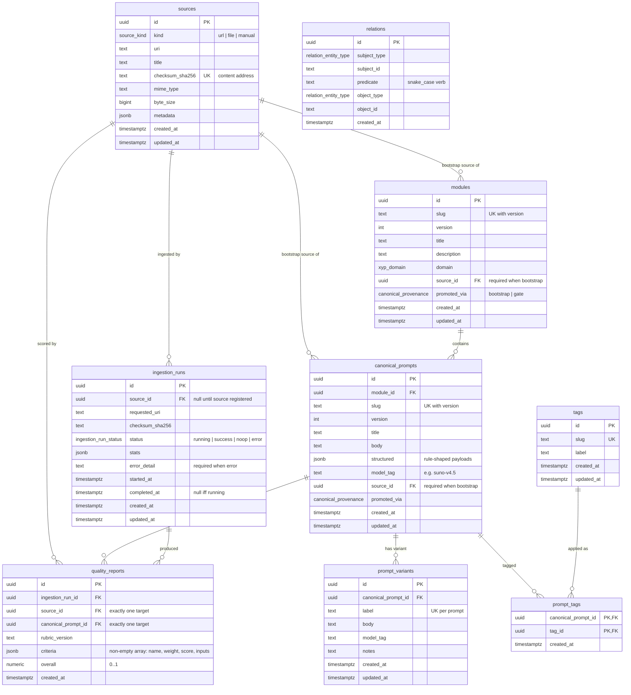

# Schema

Status: through Phase 9 (Suno submissions, takes, stub scoring) + F16 (current versions on the global path). The ERD shows the Phase 1 canonical base; later phases are described in their sections below. Source of truth: `supabase/migrations/`. This doc explains the migrations and must not contradict them.

## ERD



`relations` has no drawn edges because it is polymorphic. See below.

## Design notes

- **Foreign keys are `ON DELETE RESTRICT`.** History is permanent, so deleting a parent that knowledge still references fails loudly. The only exception is `prompt_tags`, whose join rows cascade.
- **Sources are content-addressed.** `sources.checksum_sha256` is UNIQUE. This is the race fix for Phase 2: two concurrent ingestions of the same bytes collapse to one row through `ON CONFLICT`, instead of relying on a check-then-insert in application code.
- **Canonical rows are versioned by `(slug, version)`, not unique by slug alone.** The gate (6D) appends a new version and a `knowledge_versions` row instead of overwriting. The newest version of a slug is current (`canonical_claims` and the Context Engine read it that way).
- **`promoted_via` records provenance.**
  - `bootstrap` rows were written by Phase 2 before the gate existed (F1). A CHECK constraint requires them to carry `source_id`.
  - `gate` rows trace their origin through `knowledge_versions` → `promotion_runs`, and from there to either the candidate chain or the first-party source. Candidate-promoted rows have a null `source_id`; first-party admissions keep theirs.
- **Quality reports are immutable and self-explaining.** `criteria` must be a non-empty array, so a score cannot exist without the inputs that produced it. Each report targets exactly one of a source or a canonical prompt.
- **`relations` is polymorphic.** Ids are `text`, so file-backed entities such as an agent named `health-check` fit alongside uuids.
  - On insert or update, a trigger checks that table-backed endpoints exist and that file-backed names are kebab-case. Otherwise it raises `23503`.
  - An entity type added to the enum but not handled by `xyp_relation_endpoint_exists()` is rejected (deny by default).
  - Deleting an endpoint does not touch its edges. Orphaned edges show up in the `relations_dangling` view.
- **Enums.** `xyp_domain` is a copy of `core/contracts/taxonomy.ts`, and `tests/phase-01` fails if they drift apart. Later phases extend `relation_entity_type` with `ALTER TYPE … ADD VALUE`.
- **`updated_at`.** Mutable tables get `xyp_set_updated_at()`, which uses `clock_timestamp()` so an insert and an update in the same transaction still produce distinct times. `prompt_tags`, `relations` and `quality_reports` have no `updated_at` because they are insert/delete-only.

## Access model (Phase 1)

- **RLS:** enabled on every table, with no policies, so the default is deny.
- **`anon` / `authenticated`:** every privilege on every table, view and function is explicitly revoked. Supabase grants them ALL on new public tables by default, and RLS alone still leaves TRUNCATE, REFERENCES and TRIGGER open. `tests/phase-01` proves a read as `anon` fails with `42501`, not a silent empty result.
- **`service_role`:** full grants plus BYPASSRLS. That is correct for Phase 1 only. From Phase 2 onward each component connects as its own `xyp_*` role (F7), and Phase 6D revokes canonical writes from everything except the gate.
- **Table owner:** the migration role (`postgres`), which is trusted by definition and never used by application code. This drops the `xyp_owner` role proposed in F7, because ownership by a separate non-login role adds nothing when the owner never connects.

**Multi-tenant RLS: not added. Flagged:**

1. If the Phase 16 UI reads from the browser with the anon key, it will need per-role policies. Recommendation: have the UI read server-side through a read-only `xyp_*` role, and keep the browser off the database.
2. If an external portal for payees or collaborators ever exists (Phase 13 `rights_splits`), real per-row tenant RLS becomes necessary on the Records tables.

## Phase 2 additions: `xyp_ingest_bootstrap`

Migration `20260924090000_ingest_bootstrap_role.sql` adds the temporary pre-gate canonical writer (F1):

| Table | SELECT | INSERT | UPDATE | DELETE/TRUNCATE |
|---|---|---|---|---|
| `sources`, `modules`, `canonical_prompts`, `tags`, `prompt_tags`, `relations`, `quality_reports` | yes | yes | — | — |
| `ingestion_runs` | yes | yes | outcome columns only: `source_id`, `checksum_sha256`, `status`, `stats`, `error_detail`, `completed_at` | — |
| `prompt_variants` | — | — | — | — |

- **Role attributes:** NOLOGIN, not superuser, no BYPASSRLS. Services assume it with `SET LOCAL ROLE` inside a transaction.
- **Row access:** it sees rows through per-role policies (`ingest_bootstrap_select` / `_insert` / `_update`), using `true` because the OS is single-tenant. The grants do the restricting.
- **Rollback:** removes this database's grants and policies but not the role itself. Roles are cluster-wide, so dropping one is a manual operation.
- **Phase 6D:** revokes its canonical INSERT.

## Phase 3 additions: embeddings + retrieval roles

Migration `20260924100000_embeddings.sql`:

- **pgvector** lives in the `extensions` schema (the Supabase convention).
- **New columns** on `canonical_prompts` and `sources`: `embedding vector(384)`, `embedding_model`, `embedding_input_sha256`, `embedding_truncated`, `embedded_at`.
  - A CHECK constraint keeps them all-or-nothing: `num_nulls(...) in (0, 5)`.
  - The input hash includes the model id, so changing models re-embeds every row rather than mixing vector spaces.
- **Indexes:** HNSW with `vector_cosine_ops` on both columns.
- **`xyp_match_knowledge(query vector, limit)`:** nearest neighbours across both tables. Each branch is ordered by distance with its own LIMIT so the index is used, and `similarity = 1 - cosine distance`.
- **Roles:**

| Role | Can | Can't |
|---|---|---|
| `xyp_embedder` | SELECT `canonical_prompts`, `sources`, `modules`; UPDATE only the 5 embedding columns | touch content columns, INSERT, DELETE |
| `xyp_runtime` | SELECT knowledge tables; EXECUTE `xyp_match_knowledge` | any write (retrieval also runs in a `read only` transaction) |

- **`updated_at`:** writing an embedding bumps `updated_at` through the Phase 1 trigger. That is intended, because retrieval results change once a row is embedded, and the Context Engine's cache key includes `max(updated_at)`.

## Phase 4A additions: `agent_runs`

Migration `20260924110000_agent_runs.sql` adds the generic execution log. Its columns are `agent_name`, `class xyp_agent_class`, `domain xyp_domain`, `input`, `output`, `tokens_used`, `latency_ms`, `status agent_run_status (pending|success|error)`, `error_detail`, `created_at` and `completed_at`. It is indexed on `(agent_name, created_at)` and `(status)`.

- **Append-then-seal:**
  - `xyp_runtime` has INSERT and SELECT, plus UPDATE on the outcome columns only (`status`, `output`, `error_detail`, `completed_at`, `tokens_used`, `latency_ms`).
  - The identity columns (`agent_name`, `class`, `domain`, `input`, `created_at`) can't be changed after insert (`42501`).
  - The trigger `trg_agent_runs_seal` rejects any UPDATE once a row has left `pending` (`55000`). It applies to every role, the table owner included.
- **CHECK constraints:**
  - `completed_at` is set exactly when the status isn't `pending`.
  - `error` rows must carry `error_detail`.
- **Nullable identity:** `class` and `domain` stay null only when the agent could not be resolved, so failed dispatches are still logged. `agent_name` is free text for the same reason.

## Phase 5 additions: `workflow_runs`

Migration `20260924120000_workflow_runs.sql` adds `workflow_runs`. Its columns are `workflow_name`, `spec_sha256` plus a `spec` snapshot, `input`, `output`, `status (running|success|error)`, `failed_step`, `skipped_steps`, `error_detail`, `created_at` and `completed_at`.

- **Seal:** the `trg_workflow_runs_seal` trigger seals a run once it leaves `running`.
- **Error rows:** an `error` row must name `failed_step` and carry `error_detail`.
- **Step linkage:** `agent_runs` gains `workflow_run_id` (FK, restrict) and `step_id`. They are set together at insert (pair CHECK) and can't be updated, because neither is in `xyp_runtime`'s UPDATE grant.

## Phase 6A additions: Research Intelligence schema

Migration `20260924130000_research_schema.sql` adds the 11 research tables plus the join `research_finding_evidence`. The chain, all real FKs, is `sources → research_sources → research_evidence → research_finding_evidence → research_findings → knowledge_candidates`. `contradictions` hangs off findings, `experiments` → `experiment_runs` hang off candidates, and so does `knowledge_versions`. `agent_runs.research_run_id` is new.

| Role | research chain | knowledge_candidates | canonical / knowledge_versions |
|---|---|---|---|
| `xyp_research` | INSERT + SELECT; UPDATE only on lifecycle columns of `research_runs`/`research_questions`/`research_projects`; no UPDATE or DELETE on evidence, findings or sources | INSERT only with `status = 'proposed'` (the RLS WITH CHECK rejects anything else with 42501); no UPDATE | SELECT only |

- **Evidence requirements:** `research_evidence` requires a source, `model_tag`, `confidence` in [0, 1] with `confidence_inputs`, and a non-empty claim, all NOT NULL.
- **Content addressing:** `research_sources` is unique by `content_sha256`, the same approach as `sources`.
- **Seal:** `research_runs` is sealed once it leaves `running`.

## Phase 6C additions: structured claims, Contradiction Engine, `xyp_verifier`

Migration `20260924140000_research_engines.sql`:

- **Structured claims:** `research_findings` and `knowledge_candidates` now require `claim_topic` (dotted kebab, e.g. `suno.vocal-descriptor-position`) and `claim_value jsonb`. On `research_evidence` the claim is optional, but topic and value must come together. Canonical rows carry claims in `structured.claims[] = {topic, value, model_scope}`.
- **`canonical_claims` view:** one row per claim on the latest version of each canonical slug.
- **Detection in the database:** `xyp_detect_contradictions()` (SECURITY DEFINER) runs AFTER INSERT on every finding and every candidate. A conflict is the same topic, an overlapping model scope (equal tags, or either side `model-agnostic`) and a different value. Different model versions never conflict. Research roles have no INSERT on `contradictions`, so they can neither fabricate nor suppress one.
- **`knowledge_candidate_eligibility` view:** a candidate is blocked while any open contradiction touches it, either through its own finding or by naming it as the target.
- **`xyp_verifier` role:** can UPDATE only `status`, `resolution` and `resolved_at` on `contradictions`, and can insert experiments and experiment runs. It cannot insert findings, evidence or contradictions.

## Phase 6D additions: Knowledge Promotion Gate (`xyp_promotion`), F1 closed

Migration `20260924150000_promotion_gate.sql`:

- **`xyp_promotion`** is the gate's service account and the only role with INSERT on `canonical_prompts`, `modules` and `knowledge_versions`. No role holds UPDATE on a canonical content column or DELETE/TRUNCATE on these tables; `xyp_embedder` keeps UPDATE on the five derived embedding columns only. A catalog test (`tests/phase-06d/canonical-grants.test.ts`) enumerates every role in the cluster to prove it.
- **History is required:** a deferred constraint trigger (`xyp_canonical_requires_history`) fails any transaction that commits a canonical row without its `knowledge_versions` row. This holds even for `xyp_promotion`.
- **F1 closed:**
  - `xyp_ingest_bootstrap` loses all canonical and graph grants and keeps only `sources` and `ingestion_runs`.
  - `service_role` loses INSERT/UPDATE/DELETE/TRUNCATE on `canonical_prompts`, `modules` and `knowledge_versions`.
  - Every pre-gate row is backfilled into `knowledge_versions` with `approval.mode = 'bootstrap'`.
  - New ingestion is admitted by the gate (`promoted_via = 'gate'`, `approval.mode = 'first-party-ingest'`), first-party origin only.
- **`knowledge_candidate_status`** gains `pending_approval`. A trigger enforces the state machine: `proposed → pending_approval | promoted | rejected`, then `pending_approval → promoted | rejected`. `promoted` and `rejected` are terminal.
- **`approval_queue`** (Governance-owned, F8) holds one row per item (`knowledge_candidate`, `critique_escalation`).
  - The gate may insert only `pending` rows.
  - A decision is written only by `xyp_decide_approval()` (SECURITY DEFINER, EXECUTE held by `service_role` alone) and is sealed once made.
- **`promotion_runs`** is append-only: one row per gate run, with every evaluated step and its reason, the outcome, the confidence and the threshold.
- **`regression_queue`** lists the checks a promotion owes (`retrieval`, `contradiction-guard`). It is consumed by the Phase 13 regression runner.
- **Deferred FKs:** `knowledge_versions.promotion_run_id` and `regression_queue.promotion_run_id` are deferred, so the run record is written last with the ids it produced.
- **Rollback:** refuses while first-party gate versions exist, because history is permanent.

## Phase 7 additions: module-scoped retrieval

Migration `20260924160000_subdomain_scope.sql`:

- **`xyp_match_knowledge_in_modules(query, limit, module_slugs[])`** backs the Context Engine's `scope: { modules }` option, which is a sub-domain's context path.
  - It searches only canonical prompts whose module slug is in the scope, across every version of the module.
  - Only the current version of each canonical slug is searched.
  - The scoped set is a MATERIALIZED CTE, so the scan is exact: a filtered HNSW scan can silently drop rows.
  - EXECUTE is held by `xyp_runtime` and `service_role`.
- **No new tables.** The X3LIUS Music System is data:
  - 11 gate-written `modules` rows (the parent plus ten sub-domains), admitted from `records/x3lius/music-system.manifest.yaml` by the `xyp-module-manifest-v1` normalizer.
  - `relations` edges `subdomain_of` (sub-domain → parent) and `derived_from` (module → manifest source).
- **Placement:** the gate places a promoted rule in a sub-domain module when a candidate tag equals the slug of a module that has a `subdomain_of` edge. More than one such tag is refused before queueing.

## F16 (pre-Phase 8): current versions on the global path

Migration `20260924170000_global_current_versions.sql` redefines `xyp_match_knowledge`. Canonical prompts are searched over current versions only, as an exact scan of a MATERIALIZED set, the same as the scoped path. Sources are unversioned and are unchanged, still using HNSW. Exact cosine over a few thousand 384-dim rows takes milliseconds. Revisit with pgvector ≥ 0.8 iterative scans if the corpus grows large.

## Phase 8 additions: `creative_artifacts`, `xyp_creative`, claim reads

Migration `20260924180000_creative_artifacts.sql`.

- **`creative_artifacts`:** the Creative class's only output (capability `artifact.write`, tool `write_artifact`). One row is one version of a structured artifact:
  - `schema_id`: versioned, e.g. `x3lius.lyrics/v1`;
  - `body`: schema-validated JSON;
  - `context_refs`: the canonical refs sent to the model;
  - `knowledge`: the sparsity report;
  - `model`: the frontmatter ref;
  - `agent_run_id` (FK), `brief`.
- **Versioning is derived, not trusted:**
  - A `before insert` trigger sets `lineage_id`/`version` from `parent_id`: v1 starts its own lineage, and a child is its parent's version + 1.
  - A child must keep its parent's `schema_id` (23514).
  - `unique (lineage_id, version)` makes history linear: a second child of the same parent is refused (23505).
- **Immutable for every role:**
  - A `before update or delete` trigger raises 55000, even for the table owner.
  - `xyp_creative` holds only `INSERT`/`SELECT`.
  - `service_role` holds only `SELECT`.
  - `anon`/`authenticated` hold nothing, and RLS is on.
- **`xyp_creative`:** a new component role. It writes artifacts and cannot touch canonical tables or `knowledge_candidates` (42501, `tests/phase-08/creative-artifacts.test.ts`).
- **Claim reads:** `xyp_runtime` gains `SELECT` on the `canonical_claims` view (6C, current versions only), so the Context Engine can look claims up by topic (`readClaims`, tool `retrieve_claims`, capability `context.read`).

## Phase 9 additions: the Suno trail, `xyp_execution`, `artifact.read`

Migration `20260924190000_suno_generation.sql`.

- **`suno_submissions`:** one row per accepted submission:
  - `formula_artifact_id` (FK to a `x3lius.suno-prompt/v1` artifact);
  - `agent_run_id`;
  - `adapter` (`manual` | `sunoapi`), and `provider_task_id` is null exactly when manual;
  - `suno_model`;
  - `prompt`: the exact `{title, style, excludeStyles, lyrics}` sent, copied from the artifact;
  - `provider_response`.
- **`suno_takes`:** takes per submission: an `https` `audio_url`, unique per submission (re-capture is a no-op), plus `provider_take_id`, `title`, `duration_seconds > 0` and `metadata`.
- **`take_scores`:** the scoring hook. `check (is_stub = (score is null))`: a stub row marks where a scorer plugs in and never carries a number; a real score always does. Since Phase 12 new stubs say `stub:needs-trace-analysis` (a take is audio; ARCHITECTURE F30).
- **Append-only:** all three refuse UPDATE/DELETE for every role, owner included (55000).
- **`xyp_execution`:** a new role. It may INSERT/SELECT the three tables and SELECT `creative_artifacts` (to read the artifact it submits). It cannot write artifacts or canonical knowledge (42501).
- **`artifact.read`:** a new capability for Creative, Critic, Revision, Execution and Governance. `xyp_runtime` gains SELECT on `creative_artifacts` for the `read_artifact` tool.

## After Phase 9: `creative_artifacts.warnings`

Migration `20260924200000_artifact_warnings.sql`.

- **`warnings`** (`jsonb`, not null, default `[]`, must be an array): defects the writing agent found in its own output that did not block the write. Each is one object, e.g. `{"kind":"mixed-script","word":"Лieux","path":"$.sections[0].devices[0].note"}` (ARCHITECTURE F22).
- Set once at insert through `write_artifact`, like every other column (the immutable trigger covers it). Existing rows read `[]`. The table-level grants cover the new column.

## Phase 11 additions (no migration)

- **New `creative_artifacts.schema_id` values:** `x3lius.arrangement/v1`, `x3lius.production/v1` and `x3lius.mix-report/v1`.
  - A mix report's `model` is `none`, since Mix/Master is deterministic, and its `body.analysis` is the `trace.analysis/v1` it checked.
- **New canonical claims:** `x3lius.<stage>.<metric>` = `{ min?, max? }` (`model_scope` `trace`), read through `canonical_claims` like every claim (ARCHITECTURE F24).

## Phase 12 additions: `critiques`, `critique_id`, the evaluation loop

- **`critiques`** (migration `20260925100000_critiques`): the Critic class's only output (`critique.write`).
  - Columns: `artifact_id` (the version reviewed), `previous_id` (the critique of the parent version, which chains a loop), `agent_run_id`, `schema_id` (`x3lius.critique/v1`), `body`, `checked`, `passed` (`0 ≤ passed ≤ checked`).
  - A trigger requires `previous_id` to be the critique of the reviewed artifact's parent. Rows are immutable for every role.
  - Grants: `xyp_critic` INSERT/SELECT (the `write_critique` tool); `xyp_runtime` and `service_role` SELECT (`read_critique`, capability `critique.read`: Critic, Revision, Governance); `anon`/`authenticated` nothing.
- **`creative_artifacts.critique_id`:** set by Revision on the version it writes. `check (critique_id is null or parent_id is not null)`, and a trigger requires the critique to be about the new version's parent.
- **`xyp_escalate_critique(critique_id, request)`:** `SECURITY DEFINER`; inserts one pending `approval_queue` row with `item_type critique_escalation`. EXECUTE is `xyp_evaluation_loop`'s alone (the loop controller's role).
- **New roles:** `xyp_critic`, `xyp_evaluation_loop`.

## Phase 13 additions: Records ops (`releases`, `tracks`, `rights_splits`)

Migration `20260925110000_records_ops.sql`.

- **`releases`:** `title`, `artist`, `kind` (`single` | `ep` | `album`), `upc`, `status` (`release_status`: `draft`, `scheduled`, `released`), `release_date`, `rights_check_run_id`, `agent_run_id`.
  - Registered as a draft only.
  - Transitions (else 55000): `draft → scheduled`, `scheduled → draft`, `scheduled → released`. A reschedule is a date change while the status stays `scheduled`.
  - `release_date` and `rights_check_run_id` are required outside `draft` (checks).
- **`tracks`:** `release_id`, `position` (> 0), `title`, `isrc`, `take_id` (FK `suno_takes`, the audio), `mix_report_artifact_id` (a `x3lius.mix-report/v1`, else 23514), `agent_run_id`.
  - Unique per release: `position`, `take_id`, `isrc`.
  - A track is added to a draft only (55000).
  - **An ISRC names one recording:** every track with an ISRC shares its `take_id` (23514). One take can sit on a single and an album under one ISRC.
- **`rights_splits`:** `track_id`, `version`, `payee` (null = the **unassigned share**), `percentage` (`numeric(6,3)`, 0 < p ≤ 100), `agent_run_id`.
  - Append-only for every role (55000). A change of splits is the track's next version, and `current_rights_splits` (a view, `security_invoker`) shows the highest version.
  - **Every committed set sums to exactly 100:** a deferred constraint trigger (23514) applies to every role, the owner included, so a set is written whole in one transaction.
  - A version is 1 when the track has none, and otherwise the current max or max + 1 (23514).
  - `unique nulls not distinct (track_id, version, payee)` allows at most one unassigned row per set.
  - An unassigned row is refused once the track's release is `scheduled` or `released` (55000).
- **The scheduling guard** (trigger on `releases`, 55000). Entering or staying in `scheduled`/`released` with a new date or rights run needs all of:
  - at least one track;
  - a current split set on every track;
  - no unassigned share;
  - a date: ≥ today to schedule, ≤ today to release;
  - `rights_check_run_id` naming a successful `records-rights-splits` run whose `output.result` is a `pass` for this release.
- **Codes:** the ISRC is ISO 3901 without hyphens (`^[A-Z]{2}[A-Z0-9]{3}[0-9]{7}$`). The UPC is UPC-A or EAN-13 with a valid GS1 check digit (`xyp_is_valid_gs1`). Both are assigned once: null → value, never changed or cleared (55000).
- **Concurrency:**
  - split writes serialize per track (a transaction-scoped advisory lock);
  - split, track and calendar writes lock the release row (`FOR SHARE` / the UPDATE's row lock).
  - So a split set and a schedule can't both commit past each other's check. `tests/phase-13` pins both orders.
- **Roles:**
  - `xyp_catalog`: INSERT/SELECT on the three tables; UPDATE (`upc`) on `releases`, (`isrc`) on `tracks`.
  - `xyp_release_calendar`: SELECT; UPDATE (`status`, `release_date`, `rights_check_run_id`) on `releases`.
  - `xyp_runtime`: SELECT (`read_catalog`), and EXECUTE on `xyp_resolve_take(take_id)` (`resolve_take`: one take's chain, ids, titles and schema id). `xyp_runtime` still has no SELECT on the Suno trail (the Phase 9 boundary).
  - `service_role`: SELECT only. The Supabase default ALL is revoked, so every write has an `agent_runs` row.
  - `anon`/`authenticated`: nothing. RLS is on.

## Phase 14 additions: `trace_analyses`, `rd_backlog`, the R&D queue

Migration `20260925120000_tech.sql`.

- **`trace_analyses`:** a `trace.analysis/v1` as received, with columns `schema_id`, `body`, `take_id` (FK `suno_takes`, optional), `mix_report_artifact_id` and `agent_run_id`.
  - The body is validated in code by the contract's own validator (`tech/trace/analysis.ts`). The DB never re-states the contract; it only requires `body->>'schema' = schema_id` (23514).
  - `mix_report_artifact_id` is set **once**, null → value, and only to a `x3lius.mix-report/v1` whose `body.analysis` equals this row's body (23514). Anything else is append-only (55000), for every role, the owner included.
- **`rd_backlog`:** `title` (unique on `lower(btrim(title))`, at most 120 characters), `component` (`products` | `audio-tools` | `ai-systems` | `r-and-d`), `proposal`, `rationale`, `model`, `agent_run_id`. It is immutable (55000).
  - **`rd_backlog_evidence`** (`rd_backlog_id`, `research_evidence_id`): the evidence must be the Frontier Scanner's (`specialist = 'frontier-tool-scanner-researcher'`, 23514). Every item cites at least one piece (a deferred constraint trigger, 23514 at commit).
  - **Every item is queued:** an AFTER INSERT trigger inserts its `approval_queue` row (`item_type rd_backlog_item`, request with title, component, proposal, rationale, model, run). `approval_item_type` gains `rd_backlog_item`; the rollback cannot drop an enum value.
  - **`rd_backlog_items`** (view, `security_invoker`, SELECT to `service_role`): each item with its evidence ids and its approval status, read from the queue row and never copied.
- **Roles:**
  - `xyp_trace_intake`: INSERT/SELECT `trace_analyses`, UPDATE (`mix_report_artifact_id`) only.
  - `xyp_planner`: INSERT/SELECT `rd_backlog` and `rd_backlog_evidence`, SELECT `research_evidence` and `research_sources`, nothing on `approval_queue`.
  - `xyp_runtime` reads `trace_analyses`. `service_role` reads, and decides approvals as before. `anon`/`authenticated` get nothing.

## AOS-00 prerequisite: `service_role` is read-only

Migration `20260925130000_service_role_read_only.sql` (G20, `docs/artist-os/AOS-00-baseline.md`).

- **What was open:** `service_role` still held INSERT, UPDATE, DELETE, TRUNCATE, REFERENCES and TRIGGER on 28 tables and views.
  - Phase 1 called those grants "correct for Phase 1 only"; 6D revoked them only on the canonical tables.
  - The affected tables include `knowledge_candidates`, `research_evidence`, `creative_artifacts`, `critiques`, the Suno trail, `agent_runs` and `workflow_runs`.
  - TRUNCATE also skips the immutability triggers.
- **What changes:** every one of those privileges is revoked on every relation in `public`, and the schema's default privileges are revoked too, so a table a later migration creates starts read-only for `service_role`.
- **What still works:**
  - `service_role` reads everything (RLS bypass) and decides approvals through `xyp_decide_approval` (EXECUTE is unchanged).
  - Every write goes through an `xyp_*` role, so every write has its agent run.
  - Direct maintenance runs as the migration role (`postgres`), never as the app key.
- **Proof:** `tests/aos-00/prerequisites.test.ts` covers every relation, a new table, and a refused write. The Phase 1 write probe is inverted.

## AOS-01 additions: songs, the Creative Vault, version approvals, the vault index

Migration `20260925140000_vault_songs.sql` (+ rollback). Design: `docs/artist-os/AOS-01-design.md`.

- **Songs (RECORDS, A1):**
  - `songs` holds the identity: `id`, `agent_run_id`, `created_at`.
  - `song_revisions` holds `title`, `artist`, `language`, `genre`, `status` (`song_status`: idea → archived) and `notes`. The revision number is derived by trigger (max + 1, under an advisory lock), and a song must commit with a revision (a deferred trigger).
  - `current_songs` is the latest revision per song.
- **`song_links` (A1):** one typed target per row, with exactly one of `artifact_lineage_id` (a lineage root, checked by trigger), `source_id`, `take_id`, `track_id` and `research_question_id`, plus an optional `role`.
  - There is one live link per song and target (23505).
  - Unlinking inserts a `song_link_retractions` row (with a reason), and `current_song_links` shows live links with `kind` and `target_id`.
- **Vault files (KNOWLEDGE):**
  - `sources` gains `storage` (`local-vault`), `media_class` (`document`, `lyric_sheet`, `audio`, `image`, `other`), `language` and `agent_run_id`. A Vault file has all four; a knowledge source has none.
  - `source_texts` holds extracted text (`utf8` or `unpdf`), and `source_tags` holds tags (reusing `tags`).
  - `xyp_sources_vault_guard` freezes a Vault file, except for the knowledge index's embedding columns. It also allows the one promotion: a knowledge source with the same bytes becomes a Vault file, once, through a column-level UPDATE held by `xyp_vault`.
- **`knowledge_sources` (view):** a row is a knowledge source when `storage is null` or it has a successful `ingestion_runs` row. `embedPending` and the Context Engine's generation read it, so Vault-only files stay out of every agent's grounding.
- **Approvals:**
  - `approval_item_type` gains `artifact_version`.
  - `xyp_decide_artifact(artifact, decision, approver, reason)` is SECURITY DEFINER, with EXECUTE held by `service_role` only. It records an already-decided row, one per version.
  - `artifact_approvals` gives each version's status (`draft` when there is no row) and the lineage's highest approved version.
- **Vault index:** `vault_embeddings (entity_kind, entity_id, model)` covers artifact versions, Vault files and research findings, with the input hash and truncation. An entity-exists trigger raises 23503. `xyp_match_vault(query, limit, model)` has EXECUTE held by `xyp_runtime` and `xyp_web`.
- **Roles:**
  - `xyp_vault` writes songs, links, Vault files, texts and tags (INSERT/SELECT), and runs the promotion (UPDATE on the four Vault columns only).
  - `xyp_web` reads what the UI renders and writes nothing.
  - `xyp_runtime` also reads `ingestion_runs` and `knowledge_sources` for the generation, and `source_tags` for `read_vault_file`.
  - `xyp_embedder` also reads `source_tags`, `tags`, `ingestion_runs` and `knowledge_sources`.
- **Export (not a table):** `xyp-vault-export/v1` (`knowledge/vault-io`) holds only the tables listed in `spec.ts`. It leaves out `updated_at` and the knowledge-embedding columns, because both are derived.

## AOS-02 additions: people and credits, platform links, artwork, deliveries, tasks, Vault-audio tracks, the checks

Migration `20260925150000_command_center.sql` (+ rollback). Design: `docs/artist-os/AOS-02-design.md` (decisions B1–B4, ARCHITECTURE F38).

- **People (B1):** `people (id, name, agent_run_id)` and `person_aliases (person_id, alias)` share one namespace: a name or alias belongs to one person, compared case- and space-insensitively (`lower(btrim())` unique indexes, and `xyp_person_name_free` across the two tables, 23505). Neither table changes after insert (55000); a wrong name is a new alias.
- **Credits (B1):** `credits (person_id, role, song_id | track_id, note)`, exactly one target (23514), `role` from a fixed list (`writer` … `artwork`, `other`). One live credit per target, person and role (`xyp_credits_guard`, 23505). Retracting inserts a `credit_retractions` row with a reason; `current_credits` shows live credits with the person's name.
- **Platform links (B3):** `platform_links (platform, url, release_id | track_id)`, exactly one target. `platform` is a fixed list (`spotify`, `apple_music`, `youtube`, … `other`); `xyp_platform_url_ok(platform, url)` (immutable SQL, a CHECK) requires https on that platform's host (`other`: any https URL with a dotted host). One live link per target and platform (23505, after the URL check so a wrong host reads as a wrong host). `platform_link_retractions` and `current_platform_links` as for credits.
- **Artwork:** `release_artwork (release_id, source_id)` events; the source must be a Vault image (`xyp_release_artwork_guard`). `current_release_artwork` is the newest per release.
- **Deliveries:** `release_deliveries (release_id, distributor, status, note)` events, `status` from `submitted` … `taken_down`. `current_deliveries` is the latest per release and distributor (case-insensitive).
- **Tracks from Vault audio (B4):** `tracks.take_id` is now nullable and `tracks.source_id` is added; exactly one of the two (`tracks_recording_check`), and a source must be a Vault audio file (`xyp_tracks_guard`). A recording is on a release once (`tracks_release_id_source_id_key`, like the take). The ISRC reuse rule compares the recording (`(take_id, source_id)`).
- **Tasks (B2):** `tasks (title, song_id?, release_id?, due_date)` (at most one target) and `task_events (task_id, status, note)` with `open`, `done`, `cancelled`. `current_tasks` is each task with its latest event (`open` when there is none).
- **`catalog_checks` (view):** `severity`, `subject_kind`, `subject_id`, `release_id`, `code`, `message`.
  - Blockers: `no_tracks`, `no_artwork`, `track_no_splits`, `track_unassigned_share`.
  - Warnings on releases and tracks: `no_upc`, `scheduled_no_delivery`, `released_no_platform_link`, `track_no_isrc`, `track_no_credits`.
  - Warnings on songs: `lyrics_not_approved` and `no_credits` (not for `idea` or `archived`), `status_behind`, `status_ahead`.
- **Append-only:** every new table refuses UPDATE and DELETE (`xyp_vault_immutable`, 55000); a change is a new row (a retraction, an event, a new artwork row).
- **Roles:**
  - `xyp_catalog` gains SELECT/INSERT on people, aliases, credits, links, artwork and deliveries (and their retractions), and SELECT on their `current_*` views.
  - `xyp_tasks` (new) holds SELECT/INSERT on `tasks` and `task_events`, and SELECT on `current_tasks`.
  - `xyp_web` reads everything new, `catalog_checks` included. `xyp_runtime` reads what `read_catalog` and the catalog lookup need. `service_role` reads only (G20).
  - EXECUTE on `xyp_platform_url_ok` is held by `xyp_catalog`, `xyp_web` and `service_role`; the guards are revoked from `public`.
- **Export:** the new tables join `xyp-vault-export/v1`. People (with aliases) and tasks (with events) are exported whole; credits, links, artwork and deliveries follow their songs, releases and tracks.
- **Rollback:** refuses while a track records a Vault file (it would lose the recording), then restores `tracks` and the Phase 13 `xyp_tracks_guard`.

## AOS-03 additions: the package writer guard, Vault takes, the submission gate, take ratings, the trace

Migration `20260925160000_studio.sql` (+ rollback). Design: `docs/artist-os/AOS-03-design.md` (decisions S1–S4, ARCHITECTURE F40).

- **Studio records are artifacts (S1):** style recipes (`x3lius.style-recipe/v1`), meta-tag sets (`x3lius.meta-tag-set/v1`) and Suno prompt packages (`x3lius.suno-package/v1`) are `creative_artifacts` lineages. No table was added for them: versioning, immutability, approvals (`artifact_approvals`), song links and the export are AOS-01's.
- **The package writer guard** (`xyp_creative_artifacts_package_writer`, BEFORE INSERT): a `x3lius.suno-package/v1` row must have `agent_name = 'x3lius-suno-package'` and no parent (a package is never revised), 23514.
- **Takes from the Vault (S3):** `suno_takes.audio_url` is nullable and `suno_takes.source_id` (FK `sources`) is added.
  - Exactly one of the two is set (`suno_takes_audio_check`, 23514).
  - The file must be a Vault audio file (`xyp_suno_takes_vault_audio`, SECURITY DEFINER, 23514).
  - A file is a take of a submission once (`suno_takes_submission_source_key`, 23505).
- **`xyp_suno_package_ready(uuid) returns text[]`** (SECURITY DEFINER, stable): every reason a package can't be handed off, none when it can. The reasons are:
  - not a package;
  - a missing or duplicated source role;
  - a source whose artifact, schema or version doesn't match;
  - a source version that is not approved (the exact version; an approved later version doesn't count);
  - no workflow run built it, or that run didn't succeed.

  EXECUTE: `xyp_execution` and `xyp_web` only.
- **The submission gate (S4)** (`xyp_suno_submissions_gate`, BEFORE INSERT on `suno_submissions`):
  - any readiness reason refuses the row (55000, the reasons in the message);
  - a `prompt` other than the package's `{title, style, excludeStyles, lyrics}`, or a `suno_model` other than its `sunoModel`, is 23514.

  It runs on insert only, so pre-AOS-03 rows stay. The column is still `formula_artifact_id`; since AOS-03 it holds a package.
- **`take_ratings`:** `(take_id, rating 1–5, keep, change, agent_run_id)`, both notes optional and non-blank when set (23514). Append-only (`xyp_suno_trail_immutable`, 55000). `current_take_ratings` is the latest per take.
- **The trace (views, `security_invoker`):**
  - `generation_attempts`: one row per submission. It has:
    - the package, its version and its song (the live `suno-package` link);
    - the title and model;
    - the lyric, recipe and tag set ids and versions (read from a package's `sources` only);
    - the workflow run, name and `spec_sha256`;
    - `take_count`, and `is_traced`.
  - `generation_takes`: one row per take, with the Vault file, its title and `audio_sha256` (or the URL), and the current rating.
- **Roles:**
  - `xyp_execution` gains SELECT/INSERT on `take_ratings` and SELECT on `current_take_ratings`;
  - `xyp_web` and `service_role` read the new table and views;
  - `xyp_runtime`, `anon` and `authenticated` get nothing.
- **Export:**
  - `take_ratings` joins `xyp-vault-export/v1`.
  - The closure also takes the lineages an exported artifact names in `body.sources`, the submissions of exported artifacts, their takes, and the takes' ratings.
  - On import, a submission is ordered after its package's source versions and the decisions on them, because the gate runs on import too.
- **Rollback:** refuses while any rating exists, or any take is a Vault file (either would lose the owner's data). Then it drops the trace, the ratings, the gate, the readiness function and the guard, and restores `suno_takes.audio_url NOT NULL`.

## AOS-04 additions: the brief, the run deadline, research links, kept sources and quotes, the Findings Library

Migration `20260926100000_research_mode.sql` (+ rollback). Design: `docs/artist-os/AOS-04-design.md` (decisions R1–R5, ARCHITECTURE F42).

- **The brief:** `research_questions` gains `intended_use` (non-blank when set), `urls text[]` (every one `^https?://`, via `xyp_all_http`; 23514) and `specialists text[]` (the owner's pick; non-empty when set). Set at insert: `xyp_research` still updates `status` only (42501).
- **The run deadline:** `research_runs.expires_at timestamptz not null`, default ten minutes out (existing rows filled at ALTER time, no UPDATE: sealed runs refuse updates). `xyp_research` may raise it; `openResearch` sets `n × LLM_TIMEOUT_MS + 5 min`. `sweepResearch` seals a running run past it as `error`, `abandoned: no result by <expires_at>`.
- **Kept sources and quotes:**
  - `research_sources.text` (≤ 20 000 chars, the fetcher's `TEXT_LIMIT`): what `fetch_source` read.
  - `research_evidence.quote` (non-blank when set). `xyp_research_evidence_quote` (BEFORE INSERT, SECURITY DEFINER) checks it verbatim after a whitespace squash (`xyp_squash`) against the source's `text`, or, for an ingested source, a canonical body quoting that source. Anything else, a typographic variant included, is 23514 "quote not found verbatim". A null quote (the human paths, pre-AOS-04 rows) is not checked.
- **`research_links` (R2):** `question_id` + exactly one of `artifact_lineage_id` (a lineage root; `xyp_research_links_guard`, 23514), `workflow_name` + `workflow_sha256` together, or `decision_key` (`^F[0-9]+$`); an optional non-blank `role`. One live link per brief and target (the guard, under an advisory lock; 23505). Append-only (`xyp_vault_immutable`, 55000). `research_link_retractions` (link id, reason) unlinks.
- **Views (`security_invoker`):**
  - `research_targets`: every live target of a brief, `(question_id, kind, target, role, link_id, via)`: the live `song_links` naming the brief (kind `song`, A1) union the unretracted `research_links` (kinds `lineage`, `workflow` as `name@sha256`, `decision`).
  - `current_finding_decisions`: the owner's one decision per finding (`accept` | `reject`, by, at, reason).
  - `findings_library`: the accepted findings with their brief, run, evidence count, and canonical status (`none` | `candidate` | `promoted` | `rejected`, from `knowledge_candidates`).
- **`xyp_decide_finding(uuid, text, text, text) returns uuid`** (SECURITY DEFINER): one pre-decided `approval_queue` row, `item_type research_finding` (a new enum value). Decision `accept` or `reject`, approver and reason required (22023); a second decision is 23505 (`approval_queue_item_key`). No canonical table is touched. EXECUTE: `service_role` only.
- **Roles:**
  - `xyp_research`: SELECT/INSERT on `research_links` and `research_link_retractions`; SELECT on `research_targets`, `song_links`, `song_link_retractions`, `current_song_links` (the song half of `research_targets`); UPDATE (`expires_at`) on `research_runs`; EXECUTE `xyp_all_http`.
  - `xyp_web`: SELECT on the new tables and views, and on `research_finding_evidence`, `contradictions`, `knowledge_candidates`.
  - `service_role`: SELECT only (G20); decides through `xyp_decide_finding`. `anon` and `authenticated` get nothing.
- **Export:** `research_links`, `research_link_retractions`, `research_sources`, `research_evidence`, `research_findings`, `research_finding_evidence` and `contradictions` join `xyp-vault-export/v1`. A brief reached through `song_links` brings its links, runs, evidence (sources by FK), findings, contradictions and the owner's decisions. Knowledge candidates stay out. A re-link is ordered after the retraction that freed it.
- **Rollback:** refuses while the owner has decided a finding, a brief has a link, evidence carries a quote, a source keeps text, or a brief carries an intended use, URLs or a pick. Then it drops the views, the decision function, the link tables and guard, the quote trigger, the columns and helpers, and the policies and grants it added on older tables. The enum value stays.

## AOS-04 Plan C1 additions: the file index and the graph views

Migration `20260927100000_graph_index.sql` (+ rollback). Plan: `docs/artist-os/AOS-04-plan-C1.md` (decisions S1–S4, ARCHITECTURE F46).

- **The file index** (derived: a scan rebuilds it):
  - `index_scans`: one row per scan (`trigger` `cli` | `boot` | `owner`, `roots`, `counts`). Sealed once it leaves `running` (55000); `error` is set exactly when the status is `error`, and a success carries its counts.
  - `indexed_files`: one row per `(root, path)` (23505). The path is relative and `/`-separated, with no `.`/`..` segment, backslash, drive letter, empty segment or control character (23514). `sha256` may be null only when the file is `unreadable` (and then `error` is set). Ownership: `owner_domain` + `ownership_basis` (`frontmatter` | `manifest` | `domain-path` | `shared`; shared exactly when there is no owner). A rename is a new row; the old one becomes `missing`.
  - `index_nodes`: what files declare (`agent`, `workflow`, `workflow_step`, `decision`); the id is `<kind>:<name>`, with its file, line and revision.
  - `index_edges`: file-derived relations with their file, line and the reference as written (`detail`). A null `to_id` is an unresolved reference.
  - `index_vault_status`: a Vault source's bytes `present`, `missing` or `size-mismatch`, per scan.
- **The graph views** (`security_invoker`, read as `xyp_web`):
  - `graph_nodes`: the six domains (from `xyp_domain`, backed by configuration), declared nodes, indexed files, and the live records (modules at their current version, canonical prompts, sources, lineages and versions, songs, takes, tracks, releases, runs, research rows, candidates, approvals). `backing` is `file` only for stored bytes; a Vault file nobody has checked reads `unchecked`.
  - `graph_edge_candidates`: every relation the index or a row proves, with its `provenance` (`<path>:<line>`, `<table>:<uuid>`, `<table>:<uuid>#<column>` or `ownership:<basis>:<path>`).
  - `graph_edges`: the candidates whose endpoints are both nodes. `graph_diagnostics`: the rest (`unresolved` or `dangling`).
  - `graph_link_history`: retracted song and research links with their reason.
- **Roles:**
  - `xyp_indexer` (new): SELECT/INSERT/UPDATE on `index_scans`, `indexed_files` and `index_vault_status`; SELECT/INSERT/DELETE on `index_nodes` and `index_edges` (a changed file's declarations are replaced); SELECT on four columns of `sources` (`id`, `checksum_sha256`, `byte_size`, `storage`). Nothing else (42501).
  - `xyp_web`: SELECT on the index tables and views, and on `relations` (new).
  - `service_role`: SELECT only (G20). `anon` and `authenticated` get nothing.
- **Rollback:** drops the views, tables and trigger function, and the policies and grants on `sources` and `relations`. No refusal: nothing it drops is owner data. The role stays (cluster-wide).

## Adding a table (checklist, every phase)

1. Idempotent DDL (`if not exists`, `create or replace`, enum creation wrapped in a `duplicate_object` catch).
2. `enable row level security`, `revoke all … from anon, authenticated, service_role` (the Supabase default privileges grant all three ALL on every new table), then explicit grants for the roles that need them.
3. A matching `supabase/rollbacks/<stem>.down.sql` with no CASCADE.
4. Tests in `tests/phase-NN/`, with the negative case asserting an exact SQLSTATE.

## Running it

```sh
pnpm db:setup        # local PG16 + pgvector + emulated Supabase roles (idempotent)
pnpm db:up           # apply pending migrations (XYP_DATABASE_URL, default local)
pnpm db:status
pnpm db:down [n|all] # roll back newest-first
pnpm db:seed:proof   # FK-proof seed in a rolled-back transaction
pnpm test            # each DB test file gets its own throwaway database
```
