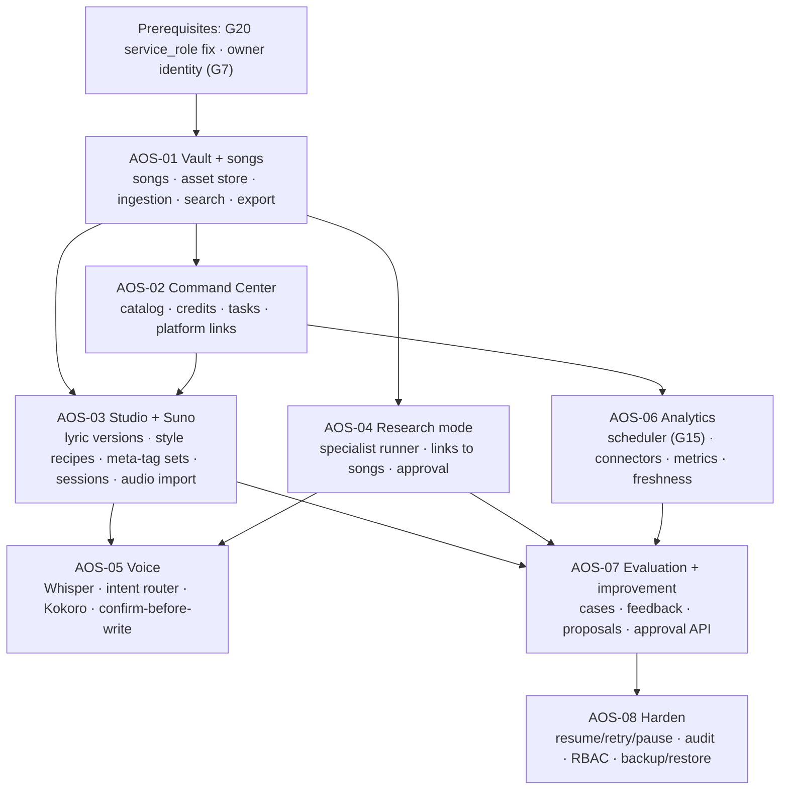

# AOS-00 — Baseline of the existing OS for the Artist OS

Source plan: [PLAN.md](PLAN.md) (operator, 2026-09-25). This file holds the AOS-00 deliverables: the current-state map (§1), the gap list (§2), the dependency map (§3) and the implementation order (§4). It also records where the plan and the running system disagree (§5), the decisions needed before AOS-01 (§6), and the gate check (§7).

Baseline measured on `main` at `b508e0d` plus Phase 14 (PR #13): 45 agents, 21 tools, 19 capabilities, 37 tables in 17 migrations, 5 workflows, 1012 tests passing.

**Legend:** **Built** means it exists and is tested. **Partial** means some of it exists, with the gap named. **Missing** means nothing exists. The owner is the module that extends; nothing gets a parallel copy.

## 1. Current-state map

### 1.1 OS kernel

| Plan component | Owner in the current system | Status | Evidence / gap |
|---|---|---|---|
| Orchestrator | `core/orchestrator` (`router.ts`, `orchestrate.ts`, `dispatch.ts`) | Built | Keyword router over 4 domains (F5), `ENTRYPOINTS` for Research, Records and Tech, and a single dispatch point with one `agent_runs` row per run. Routing goes to domains, not intents. |
| Workflow engine | `core/workflow-engine` | Partial | Versioned: each run records the spec's sha256. It runs a DAG sequentially. Missing: resumable runs, approval steps, per-step retry, conditional steps and optional inputs (Phases 13 and 14 used required-null keys as a workaround). |
| Agent registry | `core/agent-registry` + `agents/*.agent.md` | Partial | Scope, contract, tools and model are declared per agent, and `validateAll()` checks them. Missing: evaluation criteria per agent. |
| Tool registry | `core/tool-registry` + `capabilities.ts` | Built | Deny by default, with one capability per tool. The matrix is drift-tested against `AGENT_CLASSES.md`. |
| Model gateway | `core/llm` | Partial | Anthropic (native), OpenRouter and Groq (OpenAI-compatible), with schema validation and transient retries (F17). The served model is recorded in creative artifact traces only: `agent_runs` has no model column, and Critic/Revision runs don't persist it. There is no local-model provider (Whisper, Kokoro). |
| Event and schedule service | none | Missing | Nothing schedules or reacts to events. `scripts/session-start.sh` is a dev hook, not a service. |
| Policy layer | capability matrix + DB roles/RLS/triggers + `approval_queue` + `xyp_decide_approval` | Partial | Authorization for agents and tools is strong. For people, the approver is free text and there is no identity, RBAC or approval API (old Phase 15). |

### 1.2 Music domain (RECORDS)

| Plan record | Owner | Status | Evidence / gap |
|---|---|---|---|
| Song record | none | Missing | Songs are implicit: artifact lineages that share a brief, and Phase 13 `tracks → suno_takes`. No `songs` table exists to link them. |
| Lyrics (versioned, approved, translations, credits) | `creative_artifacts` (`x3lius.lyrics/v2`, `records/x3lius/creative`) | Partial | Lineages are immutable and versioned, and the critique chain links revisions (Phase 12). Missing: a draft/approved state, translations, authorship/credit notes, and human-written lyric versions (every version comes from an agent through `write_artifact`). |
| Style recipes | `x3lius.genre-style/v1` + `x3lius.suno-prompt/v1` artifacts; canonical Suno rules (F20) | Partial | These are per-song outputs. There is no reusable recipe library with tested notes. |
| Meta-tag sets | `sectionLabels` in code (F21); section `directions` stored but not sent to Suno | Missing | F21 makes section tags code-owned "until a canonical Suno rule says otherwise", which conflicts with versioned tag sets (§5 C3). |
| Song sessions | `suno_submissions`, `suno_takes`, `take_scores` (Phase 9) | Partial | The formula artifact records its lyrics, structure and genre ids, so a take is traceable to its prompt. Missing: session grouping, ratings (`take_scores` are stubs, F30), and audio import beyond an `https` URL. |
| Release records | `releases`, `tracks`, `rights_splits` (Phase 13, `records/ops`) | Partial | ISRC/UPC, calendar, splits and the Rights check exist. Missing: artwork, platform links, credits by role, delivery status, and a payee identity (F32). |

### 1.3 X3LIUS Creative Vault (KNOWLEDGE + RECORDS)

| Plan capability | Owner | Status | Evidence / gap |
|---|---|---|---|
| Original files | `sources` (uri, sha256, mime, size, metadata) | Partial | Files are content-addressed, but the bytes are not stored: `uri` is a path. There is no upload and no handling for audio or images. |
| Structured records | `canonical_prompts`, `modules`, `canonical_claims`, `tags`, `relations`; creative work in `creative_artifacts` | Built / Partial | Knowledge is versioned and gate-written. Lyrics, styles and tags live in RECORDS, so the Vault is a view across two domains, not a new store. |
| Ingestion | `knowledge/ingestion` (4 normalizers: build guide PDF, module manifest, mix rubric, Vocal DNA) | Partial | No generic document, lyric-sheet, audio or image ingestion. |
| Search | `core/context-engine` (gte-small vectors + graph, scoped per module) | Partial | Covers canonical knowledge and sources. Creative artifacts and research are not indexed. |
| Versioning + provenance | `knowledge_versions`, `promotion_runs`, artifact lineages, `agent_runs`, `workflow_runs` | Built | Every write traces to a run, and canonical writes trace to a gate run. |
| Approval state | Promotion Gate + `approval_queue` | Partial | Built for canonical knowledge. There is no approved/draft state for lyrics, styles or tags. |
| Export / re-import | none | Missing | The AOS-01 gate needs it. |
| Secrets vault, kept separate | env vars read at call time (`core/llm`, Suno adapter) | Partial | Separation holds by construction, since no secret is ever stored in a table. There is no secret store or rotation. |

### 1.4 Studio, Research, Suno, Analytics, the learning loop, UI

| Plan area | Owner | Status | Evidence / gap |
|---|---|---|---|
| Studio: song creation | `records/x3lius/song-to-suno.workflow.yaml` (Phases 8–9, 11) | Built (text only) | Brief → structure → whole-song lyrics → genre/style → Suno formula. |
| Studio: voice (Whisper / Kokoro) | none | Missing | `@huggingface/transformers` (already a dependency) ships speech-recognition and text-to-speech pipelines. A local, keyless path is likely but unverified. |
| Studio: intent router | none | Missing | Must extend `core/orchestrator`, not sit beside it (§7). |
| Research mode | `research-intelligence` (Phase 6: orchestrator, 20 specialists, evidence, contradictions, experiments, synthesis → candidates → gate) | Partial | The specialists have no LLM program, so they can't run live (Phase 6B handoff). Research can't link to songs or decisions. |
| Suno handoff | `records/x3lius/suno` (manual + sunoapi adapters, F19) | Built (manual) | The manual path is the baseline, as the plan asks. Audio import records a URL only, with no file. |
| Platform analytics | none | Missing | No connectors and no metrics tables. Phase 13 releases/tracks are the attribution targets. |
| Feedback + evaluation | Critic/Revision (Phase 12), experiments scored by the Critic (F28) | Partial | There is no curated `evaluation_case` record, and no ratings or corrections are captured from the owner. |
| Improvement proposals | `knowledge_candidates` → gate (knowledge); `rd_backlog` → `approval_queue` (features, Phase 14) | Partial | There are no proposals for agent instructions, workflows or style templates. F14 auto-approval conflicts with the plan (§5 C2). |
| Audit history | `agent_runs`, `workflow_runs`, `promotion_runs`, `knowledge_versions` | Partial | The joined `audit_log` (old Phase 15) is missing. `service_role` holds full DML on earlier tables (F32). |
| UI (Command Center, Studio, Research, Vault browser, Workflow Builder, Analytics, Admin) | none (`apps/web` reserved for old Phase 16) | Missing | Every surface is a CLI today. |

### 1.5 Data model mapping (plan record → existing owner)

| Plan record | Reuse / extend | New |
|---|---|---|
| `source_file` | `sources` (KNOWLEDGE) plus a byte store | Asset bytes storage (§6 D4) |
| `knowledge_item` | `canonical_prompts` / `modules` + `knowledge_versions` | none: a parallel item table would duplicate canonical knowledge |
| `song` | none | `songs` (RECORDS). Links artifact lineages, sessions and tracks |
| `lyric_version` | `creative_artifacts` lineages (`x3lius.lyrics/v2`) | Status, language, authorship, and an operator-authored write path |
| `style_recipe` | `x3lius.genre-style/v1`; canonical Suno rules | A reusable recipe record (design in AOS-03) |
| `meta_tag_set` | `sectionLabels` (code) | A versioned record (AOS-03, after C3) |
| `workflow` | `*.workflow.yaml` + sha256 per run | DB-stored versions for the Workflow Builder (AOS-03/07) |
| `workflow_run` | `workflow_runs` + `agent_runs` | Feedback link |
| `research_record` | `research_*` tables | Links to songs and decisions |
| `platform_metric` | none | Metrics, accounts and sync runs (AOS-06) |
| `evaluation_case` | critiques and experiments are adjacent | Curated cases and results (AOS-07) |
| `improvement_proposal` | `knowledge_candidates`, `rd_backlog`, `approval_queue` | A proposal kind per versioned target, decided in the one `approval_queue` (F8) |

## 2. Gap list

Numbered. Each gap names its owner (the module that extends) and the AOS phase that closes it.

| # | Gap | Owner | Phase |
|---|---|---|---|
| G1 | No `songs` table; songs are implicit | RECORDS (`records/`) | AOS-01 |
| G2 | File bytes not stored; no upload; no audio or image handling | KNOWLEDGE (`knowledge/source-registry`) | AOS-01 |
| G3 | Ingestion covers 4 operator formats only; no generic docs or lyric sheets | KNOWLEDGE (`knowledge/ingestion`) | AOS-01 |
| G4 | Search doesn't cover creative artifacts or research | CORE (`core/context-engine`) | AOS-01 |
| G5 | No export / re-import with links | KNOWLEDGE + RECORDS | AOS-01 |
| G6 | No draft/approved state or operator-authored versions for lyrics, styles, tags | RECORDS (`records/x3lius/creative`) | AOS-01 (lyrics), AOS-03 (styles, tags) |
| G7 | No UI at all; no owner identity or auth | new `apps/web` (reserved since Phase 0) + GOVERNANCE (RBAC) | AOS-01 (shell + Vault browser), AOS-02 |
| G8 | Releases lack artwork, platform links, credits by role, delivery status; no tasks; no collaborators | RECORDS (`records/ops`) | AOS-02 |
| G9 | No reusable style recipes or meta-tag sets; F21 keeps tags in code | RECORDS (`records/x3lius/suno`, `creative`) | AOS-03 |
| G10 | Generation sessions, ratings and audio file import | RECORDS (`records/x3lius/suno`) | AOS-03 |
| G11 | Workflow engine: no resume, approval steps, retries, conditions or optional inputs | CORE (`core/workflow-engine`) | AOS-03 (optional inputs, approval steps), AOS-08 (resume, retry, pause) |
| G12 | Research specialists can't run (no LLM program) | RESEARCH_INTELLIGENCE (`research-intelligence/specialists`) | AOS-04 |
| G13 | Research not linked to songs, styles or decisions | RESEARCH_INTELLIGENCE + RECORDS | AOS-04 |
| G14 | No voice: Whisper dictation, Kokoro read-back, an intent router, confirm-before-write | CORE (`core/llm` local provider; `core/orchestrator` intents) | AOS-05 |
| G15 | No event or schedule service | CORE (new `core/scheduler`, the one scheduler) | AOS-06 (first needed by connector syncs) |
| G16 | No platform connectors or metrics | TECH (`tech/`: connectors are integrations) + RECORDS (attribution) | AOS-06 |
| G17 | No evaluation cases; no owner feedback capture; no proposals for agents, workflows or templates | RECORDS (`records/x3lius/evaluation`) + KNOWLEDGE (gate) | AOS-07 |
| G18 | Served model not recorded on every run | CORE (`core/orchestrator/dispatch`, `core/llm`) | AOS-07 (versioned evaluation needs it); small, can land earlier |
| G19 | No audit log, approval API or RBAC (old Phase 15) | GOVERNANCE (`governance/`) | AOS-07 (approval API), AOS-08 (audit, RBAC review) |
| G20 | `service_role` full DML (TRUNCATE included) on 28 relations, wider than F32 listed | CORE (migrations) | **Done** (P): migration `20260925130000_service_role_read_only` |
| G21 | No backup/restore procedure or restore test | CORE (`core/db`) | AOS-08 |

## 3. Dependency map

**Existing modules each phase stands on:**

- **AOS-01:** the Promotion Gate, ingestion, the Context Engine and `sources`.
- **AOS-02:** Phase 13 `records/ops`.
- **AOS-03:** Phases 8–12, `records/x3lius`.
- **AOS-04:** Phase 6 `research-intelligence`.
- **AOS-05:** `core/llm`, `core/orchestrator`.
- **AOS-06:** Phase 13 releases/tracks, and TECH.
- **AOS-07:** the Phase 12 Critic, F28, `approval_queue` and `rd_backlog`.

## 4. Implementation order

The plan's order holds. Only the prerequisites (P) are added, and two gaps are placed explicitly.

0. **P (before AOS-01): done.**
   - G20: `service_role` is read-only on every relation and by default.
   - D2: the gate never auto-approves.
   - The §6 decisions are made.
   - Proof: `tests/aos-00/prerequisites.test.ts`.
1. **AOS-01 Vault + songs:** G1–G6 (lyrics), and G7 (the `apps/web` shell and the Vault browser, owner-only). First-release items 1–2.
2. **AOS-02 Command Center:** G8, and G7 (the catalog dashboard and song workspace).
3. **AOS-03 Studio + Suno:** G6 (styles, tags), G9, G10, and G11 (optional inputs, approval steps). First-release items 3–5.
4. **AOS-04 Research:** G12 and G13. First-release item 6.
5. **AOS-05 Voice:** G14, starting with a spike that proves Whisper and Kokoro run locally before anything else is built. First-release item 7.
6. **AOS-06 Analytics:** G15 and G16. The per-platform API check comes first (§5 C6). First-release item 8.
7. **AOS-07 Evaluation + improvement:** G17, G18, and G19 (the approval API). First-release item 9.
8. **AOS-08 Harden:** G11 (resume, retry, pause), G19 (audit, RBAC), G21.

## 5. Where the plan and the running system disagree

- **C1: UUID v7.** The plan says "Phase 0's UUID v7 identifiers … should carry through". This repo's Phase 0 set no such convention: every id defaults to `gen_random_uuid()` (v4, 32 defaults across 17 migrations). Postgres 16 has no built-in v7 generator.
- **C2: automatic canonical writes.** The plan says the OS "should not automatically rewrite canonical prompts". F14 still auto-approves a knowledge candidate into canonical knowledge when confidence is ≥ 0.8, its experiment validated, and every source is newer than 180 days (`knowledge/promotion-gate/decide.ts`). Since Phase 12 the Critic scores those experiments, so this path can fire.
- **C3: meta tags.** F21 decided that section tags are code's (`sectionLabels`) until a canonical rule says otherwise. The plan wants versioned meta-tag sets. The two can coexist: the code labels become the default tag set's first version. That needs a decision in AOS-03.
- **C4: old Phases 15–17.** The build guide's Phase 15 (Legal/Governance: RBAC, approval API, audit log), 16 (UI with a radial Graph View) and 17 (end-to-end validation) overlap this plan's policy layer, UI and gates. Nothing in PLAN.md mentions the Graph View or the Legal agent.
- **C5: "executable versioning, lifecycle states".** There is no shared lifecycle enum. Lifecycles are per table (candidate status, release status, research run status, approval status). Versioning is per kind: a workflow sha256 per run, artifact lineages, and `knowledge_versions`. New records follow the pattern of the table they sit next to (NAMING.md). Timestamps are `timestamptz`, so UTC holds.
- **C6: platform analytics access.** Unverified, to be checked at the start of AOS-06. To my knowledge:
  - YouTube (the Analytics API) and Instagram (the Graph API, professional accounts) have official APIs.
  - Spotify for Artists and Apple Music for Artists expose no public analytics API. Their stream counts would need a manual CSV import connector.
  - TikTok's API access is limited.
- **C7: Research mode can't run live yet.** The specialists need an LLM program and a key (G12).

## 6. Decisions before AOS-01 (DECIDED by the operator, 2026-09-25: each recommendation)

| # | Question | Options (recommendation first) |
|---|---|---|
| D1 | IDs (C1) | **Decided: (a) keep v4** for every table: consistent, and ordering comes from `created_at`. Rejected: (b) v7 for new tables only, through a SQL function; (c) switch every default to v7. The plan's "UUID v7" line is superseded. |
| D2 | F14 auto-approval (C2) | **Decided: (a) turn it off.** Every canonical change goes to the owner, which matches the plan. Rejected: (b) keep it for research findings only; (c) keep it as is. Done in the prerequisite step (P). |
| D3 | Old Phases 15–17 (C4) | **Decided: (a) absorb them.** RBAC, the approval API and the audit log go into AOS-07/08; the UI is built from AOS-01 on as the Command Center; the radial Graph View is dropped unless asked for. Rejected: (b) finish old Phase 15 first; (c) keep both sequences. |
| D4 | Where file bytes live (G2) | **Decided: (a) a local content-addressed store** (`.vault/<sha256>`, pointed to by `sources`) behind one storage interface, with Supabase Storage as a later adapter. Rejected: (b) Supabase Storage now; (c) paths only. |

Also assumed from the operator's stack, and not asked: the UI is Next.js 14 + TypeScript + Tailwind in `apps/web`, and Supabase remains the target database (local Postgres 16 until deployment).

## 7. Gate check: no duplicate bootstrap or parallel registry; every module has an owner

**Executable.** `tests/aos-00/single-kernel.test.ts` fails when a second copy appears anywhere in the source tree. It covers:

- each kernel entry point: agent registry, tool registry, capability matrix, workflow engine, dispatch, LLM runner, ingestion, Promotion Gate, Context Engine, migration runner, domain taxonomy;
- a second migrations directory;
- an agent file outside `agents/`.

**Owners of every proposed module:**

| Proposed module (plan) | Owner: extends, never duplicates |
|---|---|
| Orchestrator + intent router | `core/orchestrator` |
| Workflow engine (resume, approvals) | `core/workflow-engine` |
| Agent registry (evaluation criteria) | `core/agent-registry` + `agents/` |
| Tool registry | `core/tool-registry` |
| Model gateway (+ Whisper / Kokoro providers) | `core/llm` |
| Event and schedule service | `core/scheduler` (new, the only one) |
| Policy layer | `core/tool-registry/capabilities.ts` + DB roles + `governance/` (RBAC, approval API) |
| Creative Vault: files, ingestion, search, provenance | `knowledge/source-registry`, `knowledge/ingestion`, `core/context-engine`, `knowledge_versions` |
| Songs, lyrics, styles, tags, sessions | `records/x3lius` (creative, suno) + a new `songs` table in RECORDS |
| Releases, credits, tasks, platform links | `records/ops` |
| Research mode | `research-intelligence` |
| Suno handoff | `records/x3lius/suno` adapters |
| Platform connectors | `tech/` (integrations), with metrics attributed to `records/ops` |
| Evaluation + improvement proposals | `records/x3lius/evaluation` + `knowledge/promotion-gate` + `approval_queue` |
| UI (all surfaces) | `apps/web` (reserved in ARCHITECTURE since Phase 0) |
| Secrets | env / deployment secret store: never a table, never the Vault |
