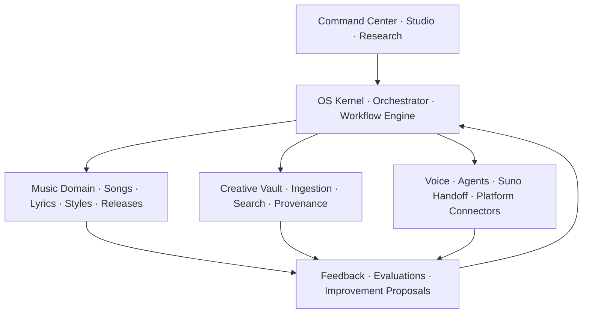
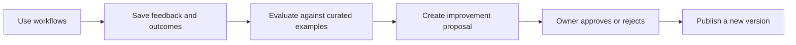

<!-- Source document for the XYP3RN Artist OS build sequence (AOS-00 → AOS-08), as the operator wrote it on
     2026-09-25. Operator-authored: kept verbatim. Where it disagrees with the running system, the disagreement
     is recorded in docs/artist-os/AOS-00-baseline.md (§5), never silently resolved here. -->

# XYP3RN Artist OS: Architecture and Build Plan

Build Variation 3 as the main operating system, with two integrated modes:

* Artist Command Center: the system of record for songs, releases, rights metadata, workflows, and performance.
* Studio mode: a voice-first creative workspace for capturing ideas and building songs.
* Research mode: an evidence-led workspace for investigating music topics and improving reusable methods.

All three modes use the same X3LIUS Creative Vault, song records, workflow engine, agents, and permission rules. The OS gets smarter by learning from saved knowledge, approved feedback, and measured outcomes, while keeping changes to canonical methods under your control.

## 1. Product structure

| Area | Purpose |
|---|---|
| Command Center | Overview of active songs, releases, tasks, recent research, alerts, and connector health |
| Songs & Releases | Catalog, lyrics, audio versions, credits, identifiers, release stages, and platform links |
| Studio | Voice capture, song creation, lyric development, Suno style and meta-tag building |
| Research | Research requests, evidence, specialist agents, comparisons, and approved findings |
| Creative Vault | All your files and structured knowledge: lyrics, styles, meta tags, workflows, prompts, research, references, and assets |
| Workflow Builder | Versioned workflows that connect agents, tools, approvals, and outputs |
| Analytics | Platform metrics and release performance with source, freshness, and history visible |
| System Admin | Agents, tools, model providers, permissions, evaluations, and audit history |

## 2. Architecture

### A. OS kernel

The shared execution layer:

* Orchestrator: routes requests to workflows, agents, and tools.
* Workflow engine: runs versioned, resumable workflows with approvals and failure handling.
* Agent registry: defines each specialist's scope, inputs, outputs, tools, and evaluation criteria.
* Tool registry: lists integrations and capabilities available to workflows.
* Model gateway: routes a task to its configured model provider and records which model/version ran.
* Event and schedule service: runs user-triggered, scheduled, and connector-driven jobs.
* Policy layer: enforces access, approval, and execution rules.

### B. Music domain

The structured source of truth for creative and release work:

* Song record: working title, artist/project, language, genre, status, collaborators, and links.
* Lyrics: versioned drafts, approved lyrics, translations, sections, and authorship/credit notes.
* Style recipes: reusable style prompts, exclusions, production direction, mood, and tested notes.
* Meta-tag sets: section tags, vocal/performance instructions, arrangement cues, and version history.
* Song sessions: briefs, selected lyric/style/tag versions, generation attempts, audio, and ratings.
* Release records: release date, platform links, artwork, ISRC/UPC, credits, ownership, and delivery status.

Every creative artifact can link to a song, workflow, source file, agent run, or release. A style or workflow can be reused across songs without losing its own history.

### C. X3LIUS Creative Vault

Use Creative Vault as the umbrella name; lyrics are one content type within it.

Store both:

1. Original files: documents, PDFs, audio, images, exports, and other uploaded or generated assets.
2. Structured records: parsed lyrics, styles, tags, workflows, research findings, and metadata that agents can search and reuse.

Each item should preserve:

* Stable ID and type
* Title, language, tags, and status
* Version and timestamps
* Original source and provenance
* Related songs, workflows, agents, and files
* Approval state and usage notes

Keep the Creative Vault separate from a secrets vault for API keys and OAuth tokens. They serve different purposes and should have different access policies.

### D. Voice and Studio mode

Studio's voice path:

1. Whisper dictation transcribes a spoken idea or instruction.
2. Intent router identifies whether it is a lyric fragment, song brief, style request, task, or general note.
3. Studio workflow saves it to the right song or creates a draft song record.
4. Kokoro reads back selected drafts, research summaries, or workflow results.
5. You approve, edit, or discard proposed changes.

The Studio should support both voice and text from the same interface. It should never silently replace approved lyrics or canonical styles.

### E. Research mode

A research workflow should:

1. Clarify the research question and the intended use.
2. Search approved vault sources and, where configured, external sources.
3. Assign relevant specialist agents.
4. Produce findings with source links, confidence, and contradictions.
5. Save the result as a research draft.
6. Let you approve reusable findings into the canonical Vault.

Research results should link back to the song, style, workflow, or decision they inform.

### F. Suno workflow integration

Treat Suno as a workflow destination, with a provider adapter around it:

* Build the song brief, lyrics, styles, and meta tags inside XYP3RN.
* Save the exact approved versions and their IDs before handoff.
* Support a manual copy/export and audio import path as the reliable baseline.
* Add a direct connector only where a supported integration is available and appropriate.
* Import resulting audio and record which prompt/style/tag versions produced it.
* Rate the result and capture what should be reused or changed.

This keeps the creation system useful even if the handoff mechanism changes.

### G. Platform analytics

Use connector adapters to normalize data from Instagram, Spotify, Apple Music, YouTube, TikTok, and other selected services.

Every metric should store:

* Platform and account
* Metric name/value and time interval
* Track, release, or artist association where known
* Source connector and retrieval time
* Data freshness or sync status

Show last synced and the platform's available reporting interval beside each figure. Some metrics may update frequently; others may be delayed or only accessible through specific artist or partner tools. Keep raw source responses where allowed, and make connector failures visible rather than showing stale numbers as current.

## 3. How the system gets smarter

Use a controlled improvement loop:

Collect signals such as:

* Your ratings and corrections
* Which lyric, style, or meta-tag versions you selected
* Which workflows you reuse or abandon
* Research findings you approve, edit, or reject
* Song outcomes you choose to record
* Connector reliability and data freshness

The system can automatically suggest a better style template or workflow based on these signals. It should not automatically rewrite canonical prompts, approved lyrics, agent instructions, or production workflows. Instead, create a proposed version, compare it against saved examples, and let you approve promotion.

## 4. Core data model

Start with these connected record types:

| Record | Connects to |
|---|---|
| source_file | Ingestion run, extracted records, songs, workflows |
| knowledge_item | Source file, language, tags, version, approval state |
| song | Lyrics, style recipes, meta-tag sets, audio, releases |
| lyric_version | Song, language, author, source, status |
| style_recipe | Song, prompt version, meta-tag set, evaluation results |
| meta_tag_set | Song, style recipe, Suno attempt |
| workflow | Agents, tools, inputs, approvals, output records |
| workflow_run | Workflow version, agent runs, artifacts, errors, feedback |
| research_record | Sources, claims, contradictions, related songs/workflows |
| platform_metric | Platform, account, song/release, interval, sync run |
| evaluation_case | Expected behavior, test inputs, score, result |
| improvement_proposal | Existing version, candidate version, evidence, decision |

Use your existing ID, lifecycle, timestamp, and versioning conventions for these records.

## 5. Build sequence

### Phase 0 — Baseline the existing OS

Work: inspect the current implementation and Phase 0 handoff; map existing modules to this design; identify what already exists.

Deliverables: current-state map, gap list, dependency map, and implementation order.

Gate: no duplicate bootstrap or parallel registry is introduced; each proposed module has an identified owner in the current system.

### Phase 1 — Establish the Creative Vault and song schema

Work: implement core records, file ingestion, metadata, versioning, provenance, access rules, and search.

Deliverables: Vault browser, ingestion status, song catalog, linked lyrics and assets.

Gate: files can be ingested, searched, versioned, and traced to their source; existing records can be exported and re-imported without losing links.

### Phase 2 — Build the Command Center and catalog

Work: create song and release views, statuses, task tracking, collaborators/credits, identifiers, and platform links.

Deliverables: catalog dashboard and song detail workspace.

Gate: a song can move from idea to release with its creative history and metadata intact.

### Phase 3 — Add Studio mode and Suno-ready workflows

Work: add lyric editing/versioning, style and meta-tag builders, generation tracking, reusable templates, and manual handoff/import.

Deliverables: end-to-end song creation workflow and Suno prompt package export.

Gate: every generation attempt can be traced to the exact lyric, style, tags, workflow version, and resulting audio.

### Phase 4 — Add Research mode

Work: implement research briefs, specialist agent execution, source capture, contradiction handling, and approval into canonical knowledge.

Deliverables: research workbench and approved findings library.

Gate: reusable findings retain their sources and cannot silently become canonical without approval.

### Phase 5 — Add Whisper and Kokoro

Work: add dictation, intent routing, voice response, and controls for confirmation before writes.

Deliverables: voice-first capture and read-back in Studio and Command Center.

Gate: voice requests reliably create the correct draft or action, with a clear confirmation step for edits to approved material.

### Phase 6 — Add platform connectors and analytics

Work: connect selected accounts; normalize metrics; add sync scheduling, retry handling, history, and freshness indicators.

Deliverables: cross-platform analytics dashboard and connector health page.

Gate: metrics are attributed to the right platform and account, include their retrieval time, and stale or unavailable data is clearly marked.

### Phase 7 — Add evaluation and the improvement loop

Work: define representative tests for agents and workflows; collect feedback; produce candidate improvements; add approval and rollback.

Deliverables: evaluation dashboard, improvement proposals, version comparison, and audit history.

Gate: a new agent, prompt, style template, or workflow version must pass its evaluation cases and be approved before production use.

### Phase 8 — Harden and expand

Work: review permissions, backup and restore, audit logs, monitoring, and collaborator access; add further platforms and workflows based on use.

Deliverables: operating procedures, recovery plan, performance targets, and release checklist.

Gate: a restore test succeeds, secrets are isolated from creative files, and workflows can be paused, retried, and audited.

## 6. First release scope

For the first usable release, build:

1. Creative Vault ingestion and search
2. Song records and versioned lyrics
3. Suno style and meta-tag builder
4. Reusable workflows with run history
5. Manual Suno handoff and audio import
6. Studio and Research modes over the same song/Vault records
7. Whisper dictation and Kokoro read-back
8. Connector status plus an initial analytics dashboard
9. Owner feedback, evaluation cases, and improvement proposals

This sequence extends your established OS core and knowledge layer while making the X3LIUS music workflows the first complete vertical slice. Phase 0's UUID v7 identifiers, executable versioning, lifecycle states, and UTC timestamps should carry through the new records.
