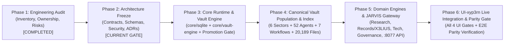

# XYP3RN OS 3.0 — Staged Migration Plan, Rollback Strategy & ADRs

**Status:** Phase 2 Architecture Freeze

---

## 1. Migration Dependency Graph & Phases

---

## 2. Phase-by-Phase Execution, Rollback Points & Acceptance Criteria

### Phase 3: Core Runtime Store (`core/sqlite/`) & Vault Engine (`core/vault-engine/`)
- **Dependencies:** Phase 2 Architecture Freeze sign-off.
- **Deliverables:**
  - `core/sqlite/schema.ts` & `core/sqlite/client.ts` (`node:sqlite` WAL runtime store with seal/append-only triggers).
  - `core/vault-engine/path-guard.ts`, `revision.ts`, `engine.ts` (path safety, No-Overwrite Guard, CAS conflict detection, `.vault-revisions/`, `promoteToCanonical()`).
- **Rollback Point:** Delete `.local-db/xyp3rn-os3.sqlite` and `.vault-revisions/`; legacy PostgreSQL (`core/db/`) remains 100% untouched.
- **Acceptance Criteria:**
  - `tests/os3-phase1/sqlite-runtime.test.ts` and `tests/os3-phase1/vault-engine.test.ts` pass 100%.
  - `tests/aos-00/single-kernel.test.ts` passes (17/17 checks).
  - `pnpm.cmd typecheck` exits 0.

### Phase 4: Canonical Obsidian Vault Population & Structural Index (`core/vault-engine/bootstrap.ts`)
- **Dependencies:** Phase 3 (`VaultEngine` + `SqliteRuntimeDb`).
- **Deliverables:**
  - Create the 54 canonical 6-sector directories (`01_CORE`..`06_GOVERNANCE`) in `C:\Users\blago\Desktop\XYP3RN-Suno-KB-v1.2-Brain`.
  - Synchronize all 52 `agents/*.agent.md`, 7 `*.workflow.yaml`, 4 manifests/rubrics, 4 governance standards, and missing `UI-xyp3rn` seed notes without overwriting existing files.
  - Batch-index all 20,189 Vault files into SQLite `index_state`.
- **Rollback Point:** `bootstrapAndSyncVault()` never modifies or deletes pre-existing user notes; added sector folders can be reverted without touching the 19,632 `ROOT_KB` files.
- **Acceptance Criteria:**
  - `tests/os3-phase2/vault-bootstrap.test.ts` passes.
  - `pnpm.cmd vault:os3 init` indexes all 20,189 files with `errors: []`.
  - Incremental `pnpm.cmd vault:os3 scan` completes in `< 5s`.

### Phase 5: Domain Engines, JARVIS Runtime & Local HTTP Gateway (`core/gateway/`)
- **Dependencies:** Phase 4.
- **Deliverables:**
  - `core/gateway/jarvis-runtime.ts`, `core/gateway/server.ts`, `core/gateway/cli.ts` bound strictly to `127.0.0.1:8077`.
  - Full command routing (`status`, `read`, `write`, `append`, `search`, `flow`, `task`, `registry`, `promote`, `connections`, `specialists`, `research`, `record`, `records`, `song new`, `compose`, `play`, `gemini`, `@context`) backed by `VaultEngine`, `ToolRegistry`, `AgentRegistry`, and `SqliteRuntimeDb`.
- **Rollback Point:** Stop `:8077` gateway process; `UI-xyp3rn` automatically falls back to its built-in deterministic `local-vault` engine.
- **Acceptance Criteria:**
  - `tests/os3-phase3/gateway.test.ts` passes (localhost binding, CORS/PNA headers, No-Overwrite Guard, canonical write block, human approval promotion).

### Phase 6: `UI-xyp3rn` Integration & End-to-End Parity Verification
- **Dependencies:** Phase 5.
- **Deliverables:**
  - `UI-xyp3rn/lib/gateway.ts` & `lib/types.ts` connected to `:8077` (`/api/health`, `/api/jarvis`, `/api/music/pulse`, `/api/vault/note`, `/api/vault/search`, `/api/approvals`, `/api/approvals/decide`).
  - `JarvisView.tsx` auto-detects live `:8077` gateway status on mount.
  - Unified launcher `scripts/start-os3.ps1` (`pnpm start:os3`).
- **Rollback Point:** `git checkout` on `UI-xyp3rn/lib/gateway.ts`, `lib/types.ts`, and `components/JarvisView.tsx`.
- **Acceptance Criteria (All Gates Must Exit 0):**
  - `UI-xyp3rn`: `npm test` (85/85), `npm run typecheck` (0 errors), `npm run lint` (0 warnings/errors), `npm run build` (9/9 static pages).
  - `xyp3rn-os-2`: `pnpm typecheck` (0 errors) + `vitest run` across Phases 1–4 and `single-kernel.test.ts` (34/34 tests).
  - Legacy PostgreSQL (`core/db/`, `supabase/migrations/`) is retained until the operator explicitly signs off on retiring legacy SQL.

---

## 3. Architecture Decision Records (ADRs)

Full ADR files are stored in `docs/os3/architecture/adr/`:

1. **[ADR-0001: Local-First and Obsidian-First Canonical Architecture](adr/ADR-0001-local-and-obsidian-first.md)**
   - **Decision:** All canonical knowledge, agent definitions, workflows, research records, creative records, and governance policies live as Markdown/YAML files in the external Obsidian Vault (`C:\Users\blago\Desktop\XYP3RN-Suno-KB-v1.2-Brain`).
2. **[ADR-0002: Minimal Local SQLite Runtime via `node:sqlite`](adr/ADR-0002-minimal-sqlite-runtime.md)**
   - **Decision:** Use Node 22's built-in `node:sqlite` (`DatabaseSync`) in WAL mode strictly for operational runtime state (`agent_runs`, `jobs`, `locks`, `sessions`, `runtime_events`, `pending_approvals`) and disposable structural cache (`index_state`), enforced by SQLite `BEFORE UPDATE` / `BEFORE DELETE` immutability triggers.
3. **[ADR-0003: Separation of Functional Domains and Physical Vault Sectors](adr/ADR-0003-domain-vs-vault-sector-separation.md)**
   - **Decision:** Keep the 6 functional domains (`CORE`, `KNOWLEDGE`, `RESEARCH_INTELLIGENCE`, `RECORDS`, `TECH`, `GOVERNANCE`) distinct from the 6 physical Vault sectors (`01_CORE`..`06_GOVERNANCE` + `ROOT_KB`). Never merge `04_RESEARCH_MATERIAL` with `TECH`.
4. **[ADR-0004: Vault Engine Single Authority & Human-Gated Promotion](adr/ADR-0004-vault-engine-and-promotion-gate.md)**
   - **Decision:** All Vault file operations pass through `VaultEngine` with path traversal guards, No-Overwrite numbering (`Note (2).md`), Compare-and-Swap (`expectedSha256`), `.vault-revisions/` SHA-256 backups, and human-approved `promoteToCanonical()` (`F35 D2`).
5. **[ADR-0005: `UI-xyp3rn` Preservation & `127.0.0.1:8077` Gateway Contract](adr/ADR-0005-ui-xyp3rn-gateway-contract.md)**
   - **Decision:** Preserve 100% of `UI-xyp3rn`'s visual geometry, animations, navigation, and tokens; connect it to the local Node.js runtime via `http://127.0.0.1:8077` with Same-Origin/Host allowlisting and deterministic offline fallback.
