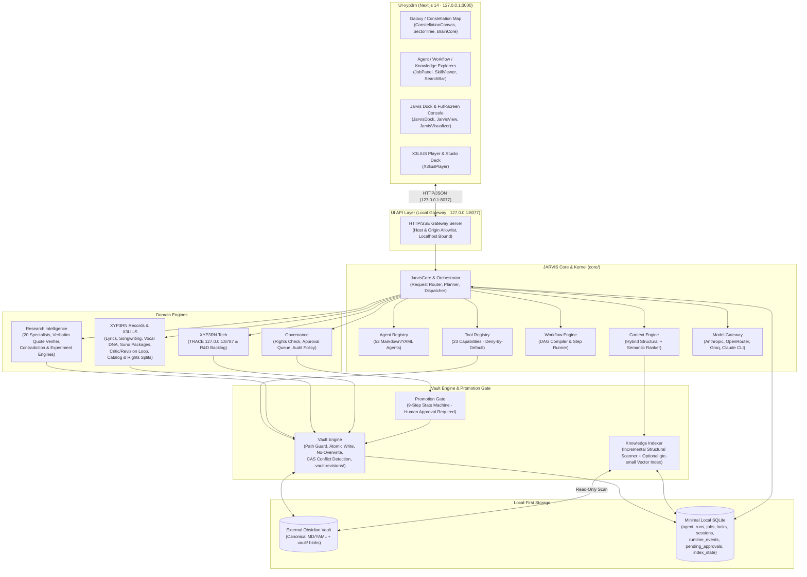

# XYP3RN OS 3.0 — System Architecture Specification (Architecture Freeze)

**Status:** Phase 2 Architecture Freeze
**Target Runtime:** Local Node.js >=22 + TypeScript (`strict: true`, `erasableSyntaxOnly: true`)
**Canonical Storage:** External Obsidian Vault (`C:\Users\blago\Desktop\XYP3RN-Suno-KB-v1.2-Brain`)
**Operational Database:** Minimal Local SQLite (`.local-db/xyp3rn-os3.sqlite` via `node:sqlite`)
**Operator Interface:** `UI-xyp3rn` (`C:\Users\blago\Desktop\building-agentic-systems\XYP3RNOS\UI-xyp3rn`)

---

## 1. High-Level System Topology



---

## 2. Subsystem Definitions & Responsibilities

### 2.1. Local Runtime (`core/runtime/`, `core/sqlite/`)
- Runs entirely on the operator's machine under Node.js >=22.
- Zero cloud database or remote orchestration dependency.
- Persists transient and operational state in `SqliteRuntimeDb` (`core/sqlite/client.ts`) using WAL mode and SQLite immutability/seal triggers (`core/sqlite/schema.ts`).

### 2.2. Vault Engine (`core/vault-engine/`)
- **Sole file-mutation authority** over the Obsidian Vault. No agent, workflow, or domain module may call `fs.writeFile` or `fs.unlink` on the Vault directly.
- Enforces path traversal protection, sector validation (`01_CORE`..`06_GOVERNANCE`), extension allowlisting, No-Overwrite Guard (`Note (2).md`), optimistic concurrency Compare-and-Swap (`expectedSha256`), atomic writes (`temp -> rename` with Windows `EBUSY`/`EPERM` backoff), content-addressed revision snapshots (`.vault-revisions/<sha256>`), and audit event emission (`runtime_events`).

### 2.3. JARVIS Core & Orchestrator (`core/src/jarvis/`, `core/orchestrator/`)
- Single front door for CLI (`pnpm jarvis`), HTTP (`POST /api/jarvis`), and voice directives.
- Routes requests across the four target operational domains (`RESEARCH_INTELLIGENCE`, `RECORDS`, `TECH`, `GOVERNANCE`), resolves `@path` and `@agent` context references, enforces `PENDING_HUMAN_APPROVAL` on all canonical writes and split proposals, and logs every execution in `agent_runs`.

### 2.4. Agent Registry (`core/agent-registry/`)
- Loads and validates all 52 `.agent.md` definitions (`agents/*.agent.md`, synchronized to `01_CORE/02_Agents/` and `03_RESEARCH_INTELLIGENCE/06_Specialists/`).
- Enforces single-valued `class` (`AgentClass`), `domain` (`Domain`), `model`, declared `capabilities`, `tools`, and JSON Schemas (`inputSchema`, `outputSchema`).

### 2.5. Tool Registry (`core/tool-registry/`)
- Maps every registered tool to exactly one `Capability` from the 23-capability matrix (`capabilities.ts`).
- Enforces deny-by-default authorization (`authorize(agentClass, toolName)`) both at dispatch pre-flight and on every tool call.

### 2.6. Context Engine (`core/context-engine/`)
- Assembles ranked, provenance-tagged context bundles for agents and operator queries over two corpora:
  1. `knowledge` (default): canonical rules, claims, and modules from `02_KNOWLEDGE_LAYER/`, `ROOT_KB`, and `05_XYP3RN_RECORDS/06_X3LIUS_MUSIC_SYSTEM/*.yaml`.
  2. `vault`: all indexed Vault notes, songs, lyric sheets, and research findings.
- Combines structural index matches (`index_state`) with optional local 384-dim `Supabase/gte-small` vector similarity (`knowledge/vector-retrieval/`) and `[[wikilink]]` graph proximity.

### 2.7. Workflow Engine (`core/workflow-engine/`)
- Compiles and validates YAML workflow specifications (`*.workflow.yaml`), verifies that every referenced agent exists in `AgentRegistry`, rejects cycles, and executes steps in topological order (`topoOrder`).
- Stamps every `jobs` row (`kind = 'workflow'`) with `spec_sha256` and links each step's `agent_runs` row via `job_id` + `step_id`.

### 2.8. Model Gateway (`core/llm/`)
- Provider-agnostic LLM execution layer supporting Anthropic (`@anthropic-ai/sdk`), OpenRouter, Groq, and local Claude CLI (`claude-cli.ts`).
- Reads API keys strictly from `process.env` at call time, validates model outputs against the caller's JSON Schema, and retries transient upstream 408/429/5xx faults with backoff.

### 2.9. Knowledge Index (`core/vault-engine/`, `knowledge/knowledge-graph/`)
- Scans the Obsidian Vault incrementally (`mtime_ms + byte_size` fast path; batched 400-file SQLite WAL transactions) into `index_state`.
- Extracts YAML frontmatter, tags, `[[wikilinks]]`, SHA-256 checksums, and incoming/outgoing link graphs.
- Explicitly treated as a **disposable, non-canonical cache** that can be dropped and rebuilt from the Obsidian Vault at any time.

### 2.10. Promotion Gate (`knowledge/promotion-gate/`, `core/vault-engine/`)
- The **only code path** permitted to write or update canonical notes (`02_KNOWLEDGE_LAYER/`, `01_CORE/00_Identity/`, `01_CORE/01_System_Prompts/`, `06_GOVERNANCE/00_Policies/`, `canonical/`).
- Evaluates the 9-step state machine (source verification, verbatim quote check, contradiction check, confidence scoring) and queues candidates in SQLite `pending_approvals`.
- Requires an explicit human `approved` decision (`F35 D2` — auto-approval is permanently disabled) before calling `VaultEngine.promoteToCanonical()`.

### 2.11. Research Intelligence (`research-intelligence/`)
- Coordinates the 20 specialist research agents over operator-approved URLs (`brief.ts`).
- Enforces verbatim quote verification against fetched source text, runs contradiction detection against current canonical claims, evaluates A/B experiments, and writes briefs, evidence, and findings into `03_RESEARCH_INTELLIGENCE/` via `VaultEngine`.

### 2.12. XYP3RN Records & X3LIUS Music System (`records/`)
- **X3LIUS Creative & Studio (`records/x3lius/`):** Manages the 10 creative sub-domains (`songwriting`, `lyrics`, `vocal-dna`, `composition`, `arrangement`, `genre-style`, `suno`, `production`, `mix-master`, `evaluation`), enforces the mixed-script homoglyph guard (`F22`), runs the Critic/Revision loop (`MAX_REVISIONS = 3`), and builds versioned Suno prompt packages (`x3lius.suno-package/v1`) in `05_XYP3RN_RECORDS/06_X3LIUS_MUSIC_SYSTEM/`.
- **Records Ops (`records/ops/`):** Manages songs, tracks, releases, credits, platform links, deliveries, tasks, and append-only `rights_splits` (enforcing `F31`: every split set must sum to `100.000`, and any unassigned `null` payee blocks release scheduling).

### 2.13. XYP3RN Tech & Governance (`tech/`, `governance/`)
- **Tech (`tech/`):** Runs the local TRACE audio analysis service (`127.0.0.1:8787`, `trace.analysis/v1` -> `trace.report/v1`) and R&D backlog generator (`tech-r-and-d`).
- **Governance (`governance/`):** Enforces rights-conflict checks (`records-rights-splits`), tool capability boundaries, human approval decisions (`pending_approvals`), and append-only audit logging (`runtime_events` + `06_GOVERNANCE/05_Audit_Logs/`).

### 2.14. UI API Layer (`core/gateway/` ↔ `UI-xyp3rn/lib/gateway.ts`)
- Binds strictly to `127.0.0.1:8077`, enforces `Same-Origin & Host Allowlist` + `Access-Control-Allow-Private-Network: true`, and serves `UI-xyp3rn` with zero visual modifications to the interface.

---

## 3. Module Dependency Direction Rules

Dependencies flow strictly downward. Upward or circular imports are forbidden:

```
UI-xyp3rn (Presentation Layer)
   ↓ HTTP JSON (127.0.0.1:8077)
UI API Gateway (core/gateway)
   ↓
JARVIS Core & Orchestrator (core/src/jarvis, core/orchestrator, core/workflow-engine)
   ↓
Domain Engines (research-intelligence, records, tech, governance) + Context Engine (core/context-engine)
   ↓
Tool Registry (core/tool-registry) + Agent Registry (core/agent-registry) + Model Gateway (core/llm)
   ↓
Promotion Gate (knowledge/promotion-gate) + Vault Engine (core/vault-engine) + SQLite Runtime (core/sqlite)
   ↓
Core Contracts (core/contracts/taxonomy.ts)
```

- `core/contracts/taxonomy.ts` imports **nothing**.
- `core/sqlite/` imports only `node:sqlite`, `node:crypto`, `node:fs`, `node:path`, and `core/contracts/taxonomy.ts`.
- `core/vault-engine/` imports only `core/sqlite/`, `knowledge/obsidian/parser.ts`, `yaml`, and Node stdlib.
- Domain modules never import `UI-xyp3rn` or `core/gateway/`.
- `UI-xyp3rn` communicates with the runtime exclusively over typed HTTP requests to `127.0.0.1:8077` (with deterministic in-memory fallback when offline).
